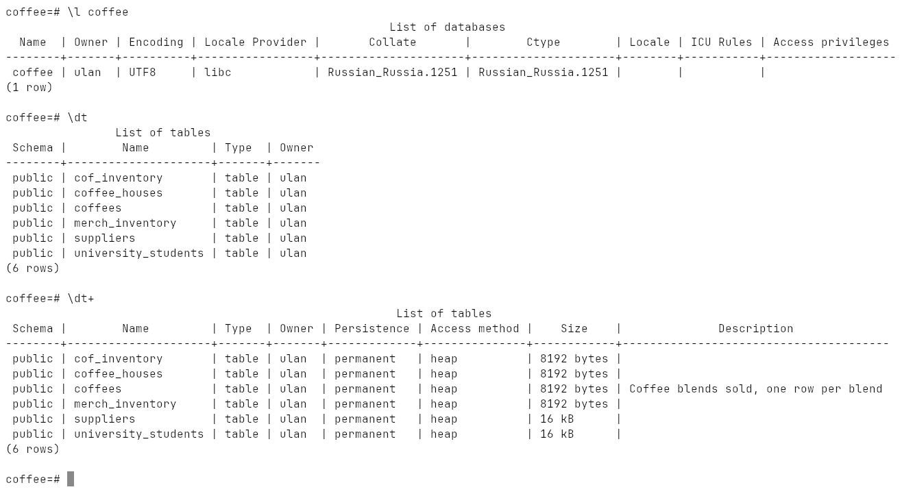
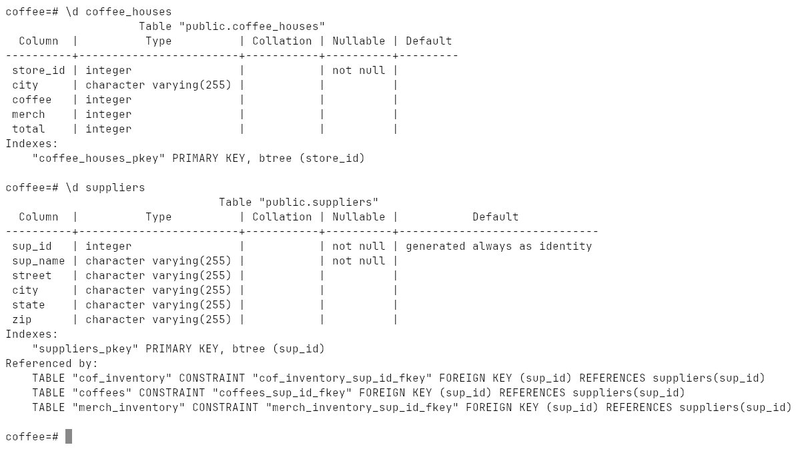
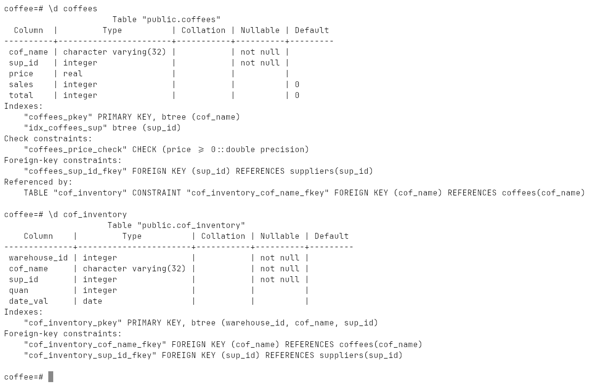
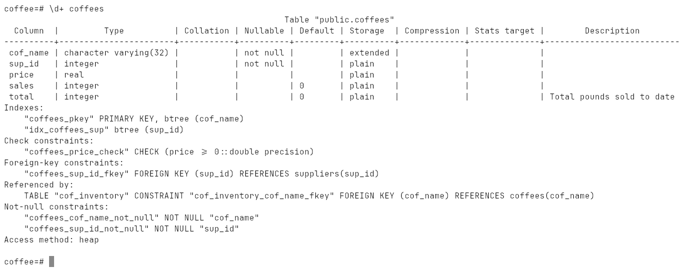
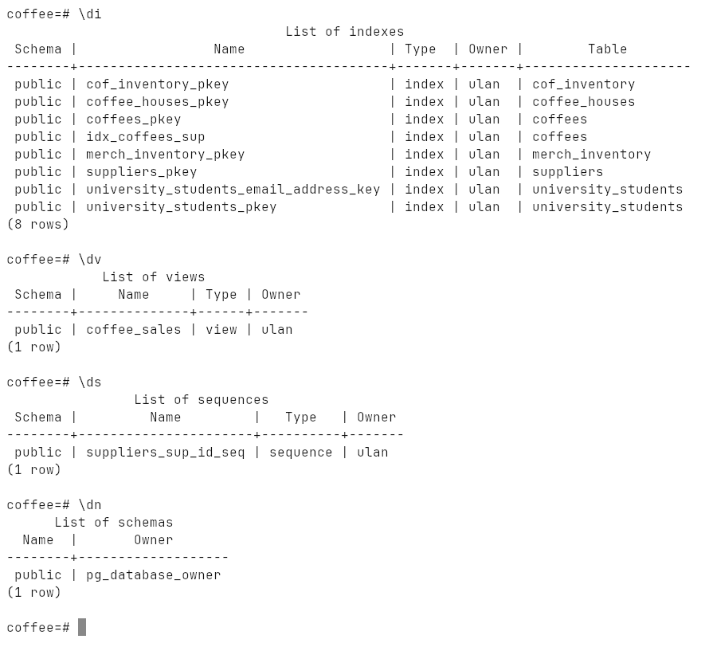
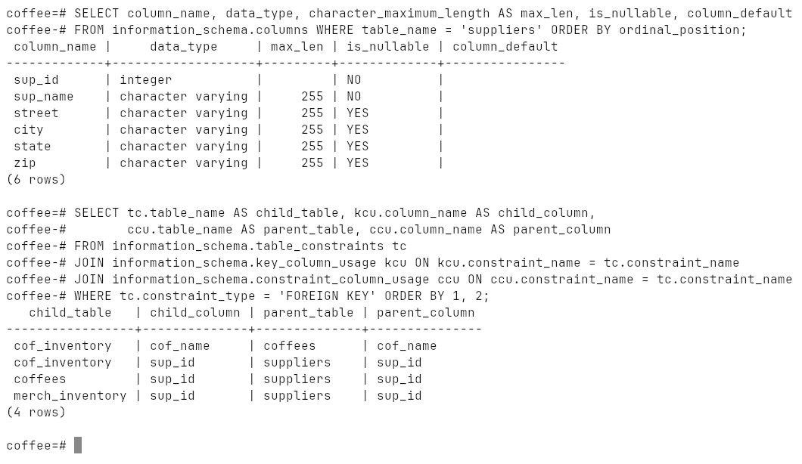
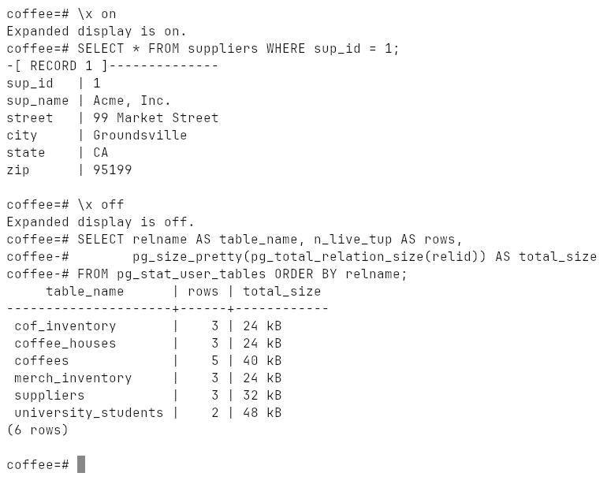
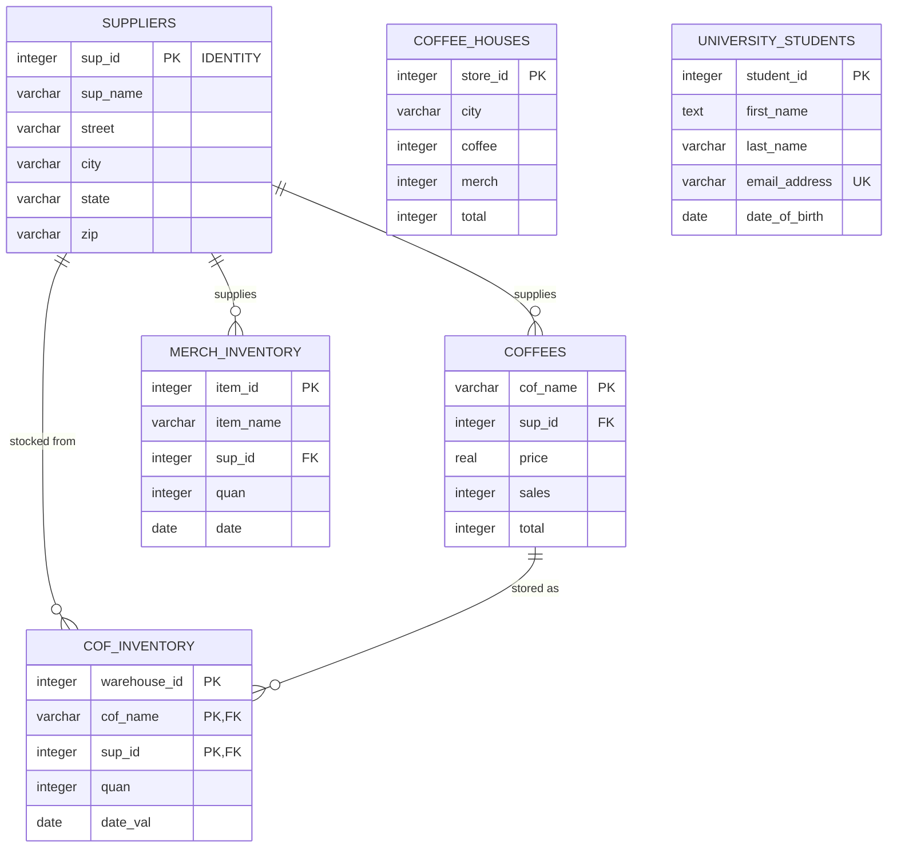

# Week 10: Viewing Database and Table Structure

`\l`, `\dt`, `\d`, `\d+`, `\di`, `\dv`, `\ds`, `\dn`, `\x`, the same
information through `information_schema` and `pg_catalog`, and an ER diagram
of the database.

Run on PostgreSQL 18.6 (Windows 10, EDB installer, port `1569`).

## How to run

```bash
psql -h localhost -p 1569 -U ulan -d ulan -f lab.sql
```

[`lab.sql`](lab.sql) creates a database `coffee`, loads
[`schema.sql`](schema.sql) into it (the six tables of the lecture example:
`suppliers`, `coffees`, `coffee_houses`, `cof_inventory`, `merch_inventory`,
`university_students`), explores it, and drops it at the end.
Transcript: [`output.txt`](output.txt), screenshots: [`screenshots/`](screenshots).

## `\dt` — the tables



`\dt+` adds the size and the description.

## `\d table` — one table

Columns with type, collation, nullability and default, then indexes,
check constraints, foreign keys, and — on the parent side — `Referenced by`:





`\d+` shows storage, compression and the comments set with `COMMENT ON`:



## The other `\d` commands

| Command | Lists |
|---|---|
| `\l` | databases |
| `\dn` | schemas |
| `\dt` | tables |
| `\di` | indexes |
| `\dv` | views |
| `\ds` | sequences |
| `\df` | functions |
| `\d` | all relations |



## The same with SQL

`\d` is just a front-end for catalog queries. `information_schema` is the
SQL-standard way to ask the same questions, which also works from programs:



`\x on` turns wide rows into a vertical list; `pg_stat_user_tables` gives row
counts and sizes:



## ER diagram

The foreign keys above, drawn as a diagram. In pgAdmin the same picture is
*database → Schemas → Tables → right click → ERD for database*; here it is
written in Mermaid so GitHub renders it:


