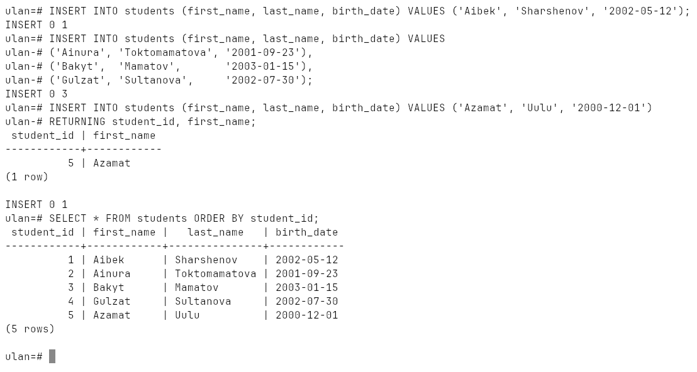
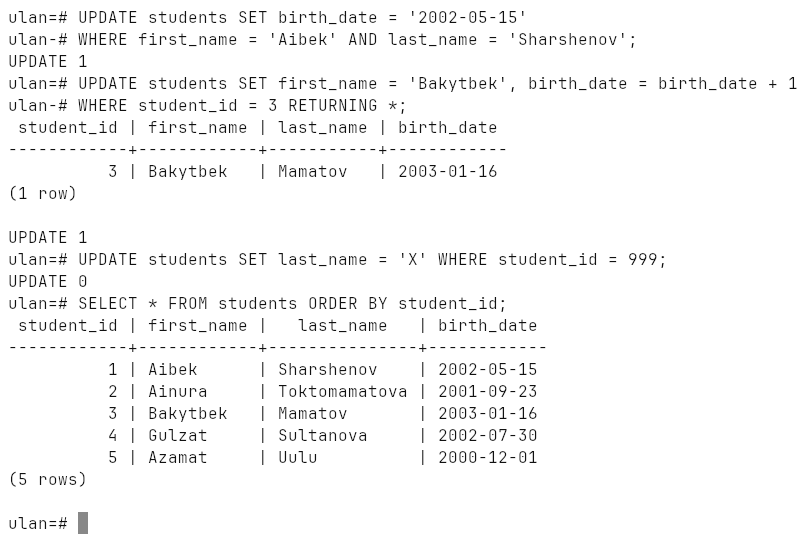
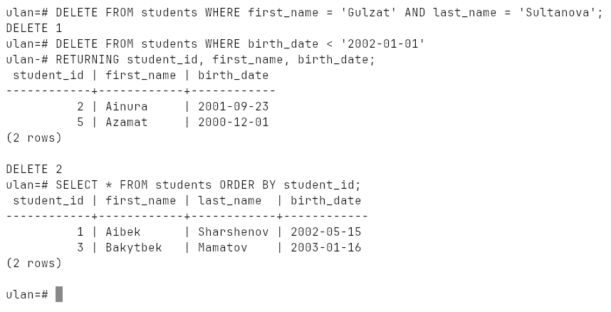
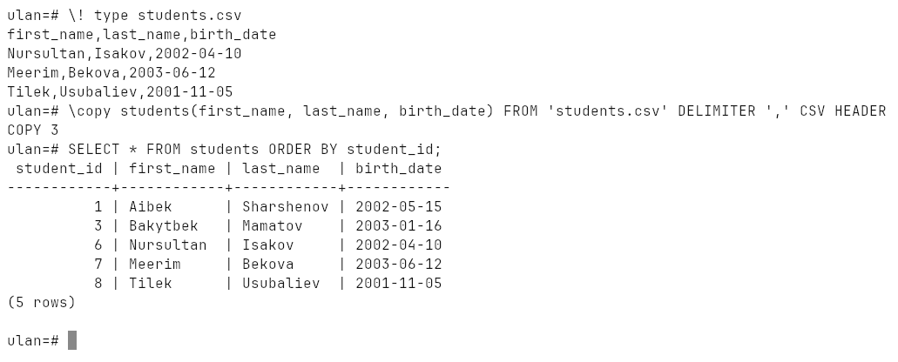
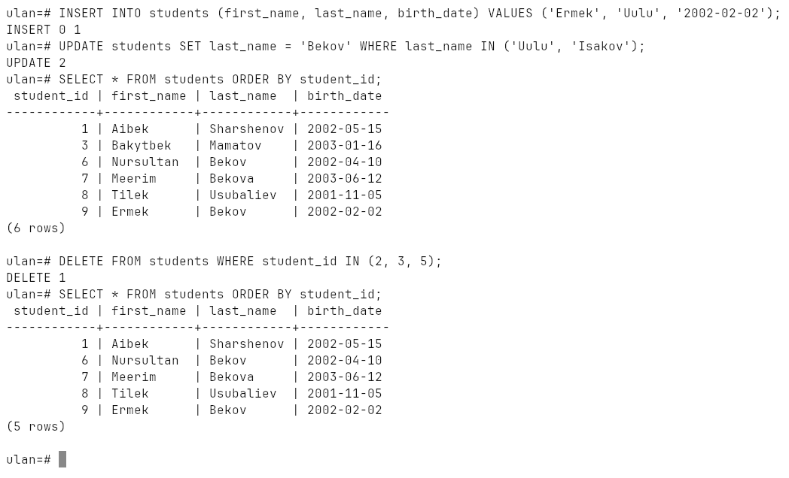
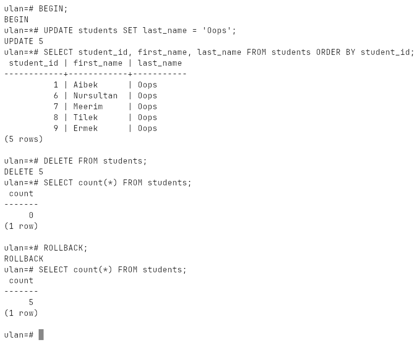

# Week 11: Basic Data Operations

`INSERT` (one row, many rows, `RETURNING`, `INSERT ... SELECT`), `UPDATE`,
`DELETE`, bulk loading from CSV, bulk `UPDATE` / `DELETE`, what a missing
`WHERE` does, and `TRUNCATE`.

Run on PostgreSQL 18.6 (Windows 10, EDB installer, port `1569`).

## How to run

```bash
psql -h localhost -p 1569 -U ulan -d ulan -f lab.sql
```

Run it from this folder — it reads [`students.csv`](students.csv). It cleans
up after itself. Transcript: [`output.txt`](output.txt), screenshots:
[`screenshots/`](screenshots).

## INSERT

One row, several rows in one statement, and `RETURNING` to get the generated
`student_id` back without a second query:



## UPDATE

Always with a `WHERE`. Several columns at once, `RETURNING` to see the result,
and a `WHERE` that matches nothing — `UPDATE 0`:



## DELETE

`DELETE ... WHERE birth_date < '2002-01-01'` removes Ainura and Azamat;
`RETURNING` shows exactly which rows went:



## Bulk insert from CSV

```
first_name,last_name,birth_date
Nursultan,Isakov,2002-04-10
Meerim,Bekova,2003-06-12
Tilek,Usubaliev,2001-11-05
```

The lecture's `COPY ... FROM '/path/to/students.csv'` reads the file on the
**server**. `\copy` is the same command run by `psql`: it reads the file on
the client and streams it to the server, so a relative path works and no
server file permissions are needed.

```
\copy students(first_name, last_name, birth_date) FROM 'students.csv' DELIMITER ',' CSV HEADER
COPY 3
```



## Bulk UPDATE and DELETE

`WHERE last_name IN ('Uulu', 'Isakov')` renames two students in one
statement; `WHERE student_id IN (2, 3, 5)` deletes three (only those that
still exist — `DELETE 1` here, because 2 and 5 were already deleted above):



## Without WHERE

Inside a transaction, so it can be undone: `UPDATE` without `WHERE` renames
**every** student, `DELETE` without `WHERE` empties the table. `ROLLBACK`
brings it all back:



`TRUNCATE` empties a whole table at once — faster than `DELETE` for large
tables, and it can reset `SERIAL` counters with `RESTART IDENTITY`.
