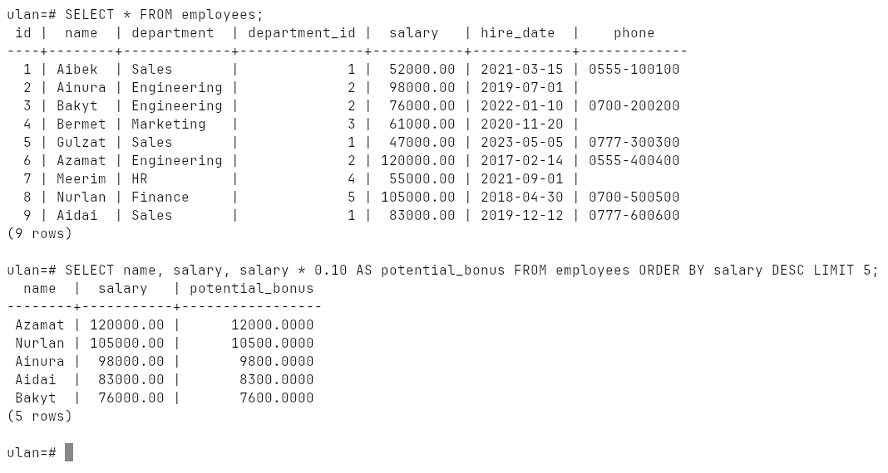
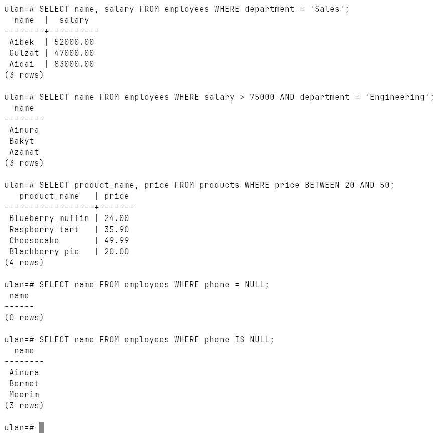
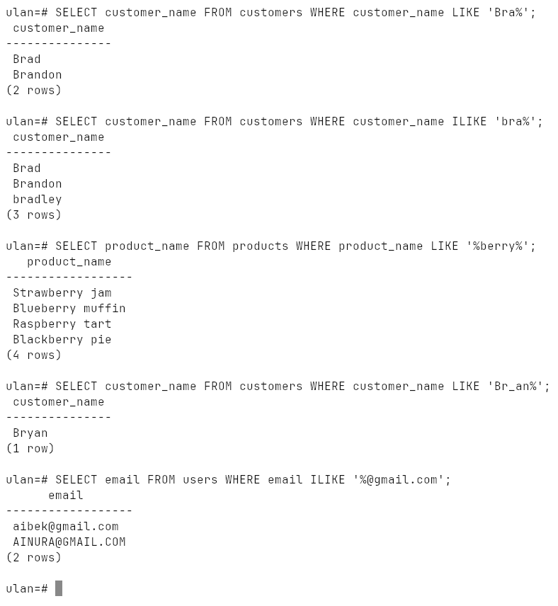
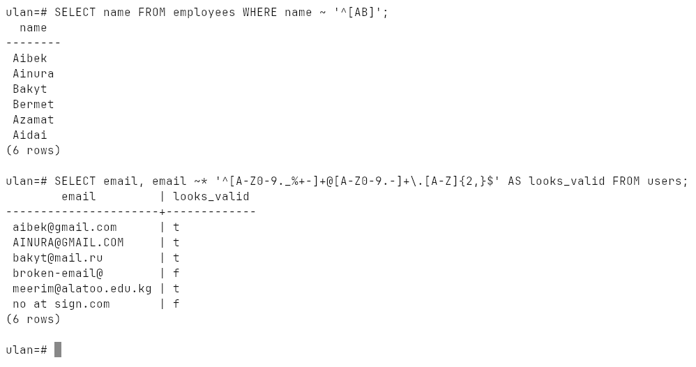
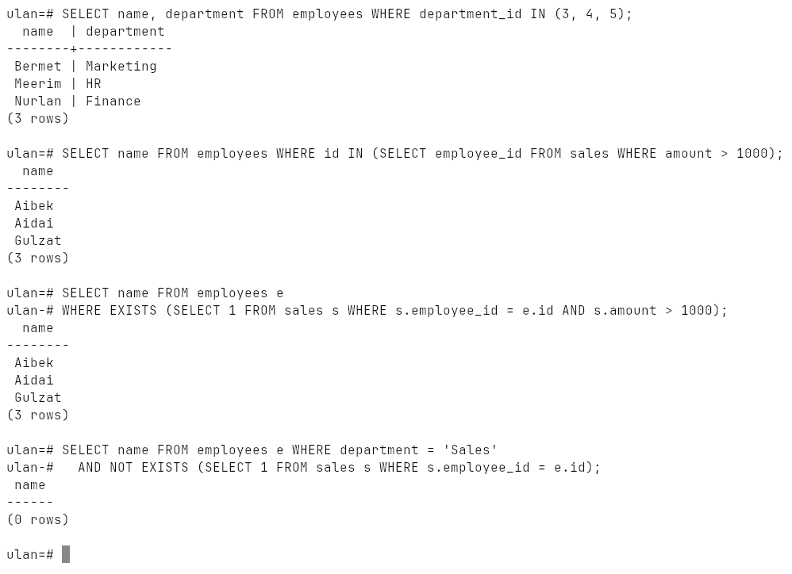
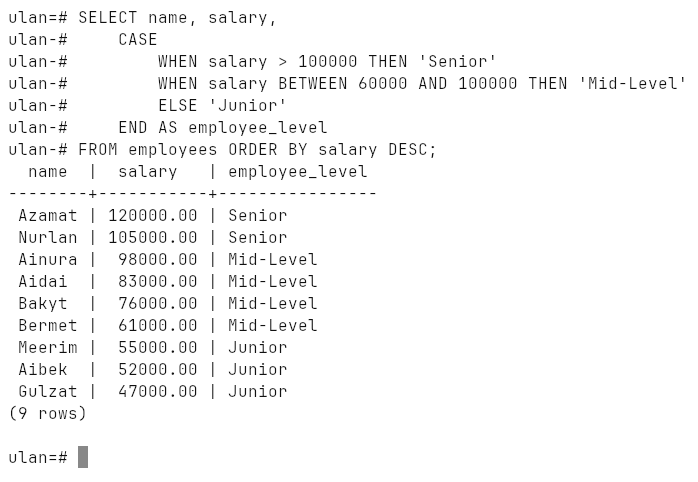
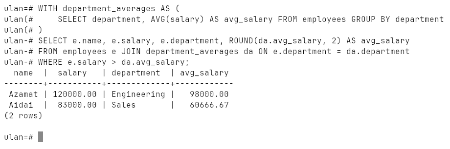

# Week 12: Querying Data

`SELECT` with computed columns and aliases, `WHERE` with comparison, logical,
range and `NULL` operators, `LIKE` / `ILIKE`, regular expressions, `IN` and
`EXISTS`, `CASE`, CTEs, plus `ORDER BY`, `LIMIT` and `DISTINCT`.

Run on PostgreSQL 18.6 (Windows 10, EDB installer, port `1569`).

## How to run

```bash
psql -h localhost -p 1569 -U ulan -d ulan -f lab.sql
```

[`lab.sql`](lab.sql) creates `employees`, `departments`, `sales`, `products`,
`customers` and `users`, runs every query, and drops the tables again.
Transcript: [`output.txt`](output.txt), screenshots: [`screenshots/`](screenshots).

## SELECT

`SELECT *`, chosen columns, and a value computed on the fly and renamed with
`AS`:



## WHERE

| Kind | Operators |
|---|---|
| comparison | `=`, `<>` / `!=`, `>`, `<`, `>=`, `<=` |
| logical | `AND`, `OR`, `NOT` |
| range | `BETWEEN a AND b` (inclusive) |
| null check | `IS NULL`, `IS NOT NULL` |

`phone = NULL` returns **0 rows** even though three employees have no phone —
`NULL` is not equal to anything, not even `NULL`. It needs `IS NULL`:



## LIKE and ILIKE

`%` is any number of characters, `_` exactly one. `ILIKE` is PostgreSQL's
case-insensitive `LIKE`, which is why `'bra%'` also finds `bradley` and
`'%@gmail.com'` finds `AINURA@GMAIL.COM`:



## Regular expressions

| Operator | |
|---|---|
| `~` | matches, case-sensitive |
| `~*` | matches, case-insensitive |
| `!~` | does not match, case-sensitive |
| `!~*` | does not match, case-insensitive |

`'^[AB]'` — names starting with A or B. The e-mail check flags
`broken-email@` and `no at sign.com`:



## IN and EXISTS

`IN` checks a value against a list or a subquery; `EXISTS` asks whether the
subquery returns any row at all and stops at the first one. `NOT EXISTS`
finds the sales people with no sales:



## CASE

SQL's if / else, here sorting employees into levels by salary:



## Common Table Expressions

`WITH department_averages AS (...)` names a subquery and the main query joins
it like a table. Employees above their own department's average:

```
  name  |  salary   | department  | avg_salary
--------+-----------+-------------+------------
 Azamat | 120000.00 | Engineering |   98000.00
 Aidai  |  83000.00 | Sales       |   60666.67
```


