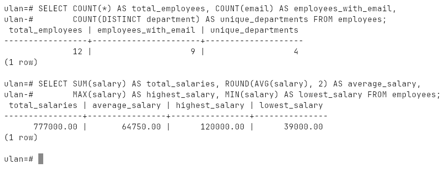
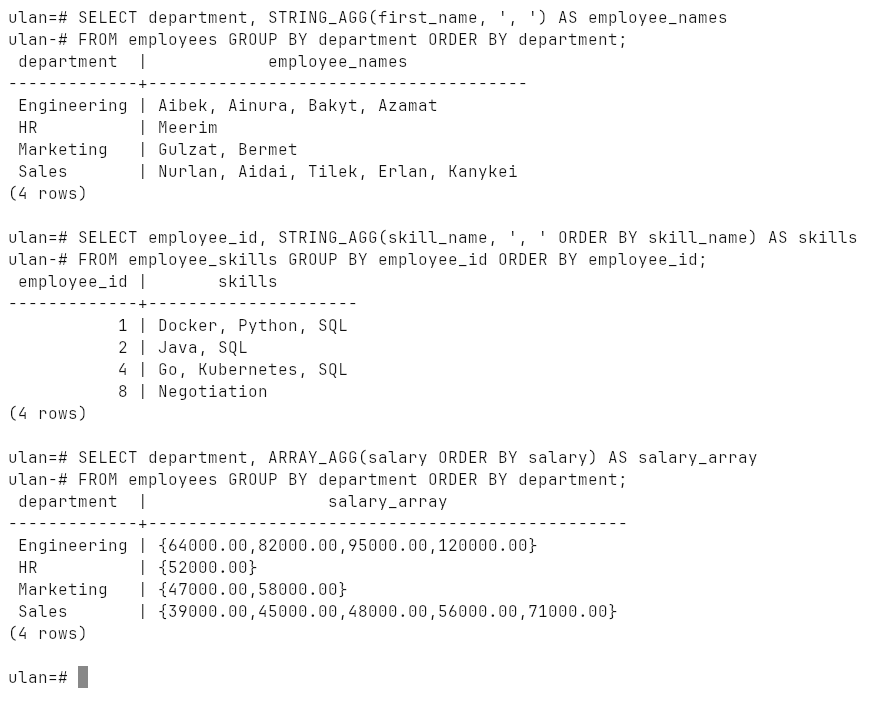
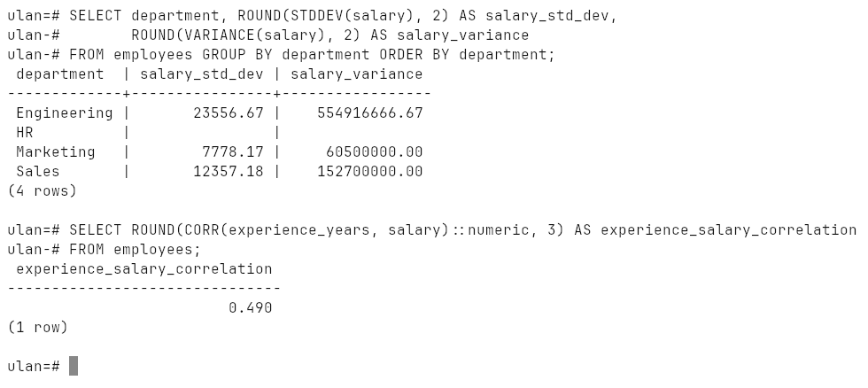
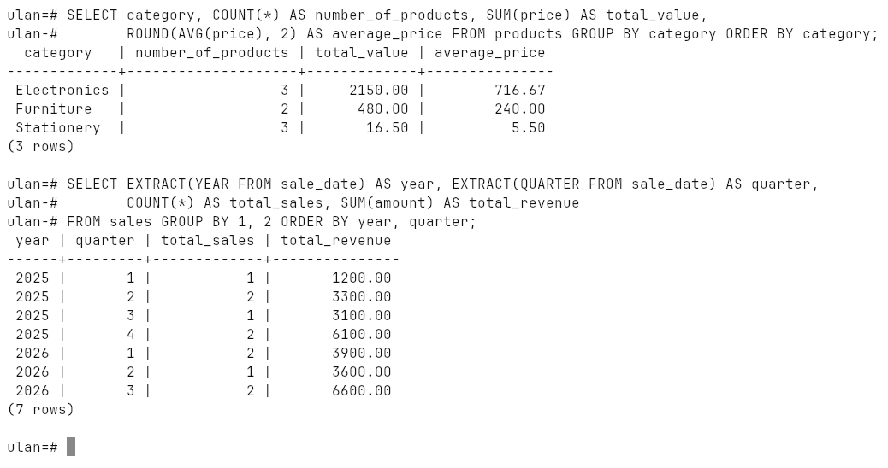
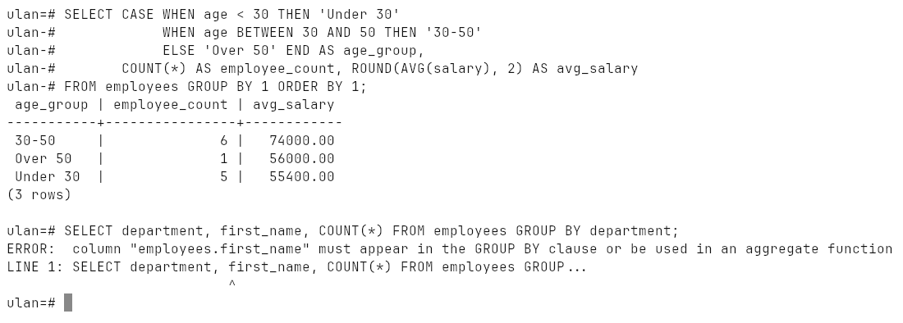
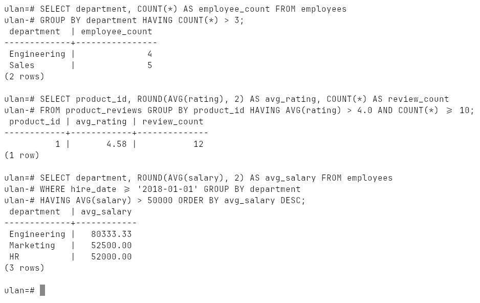
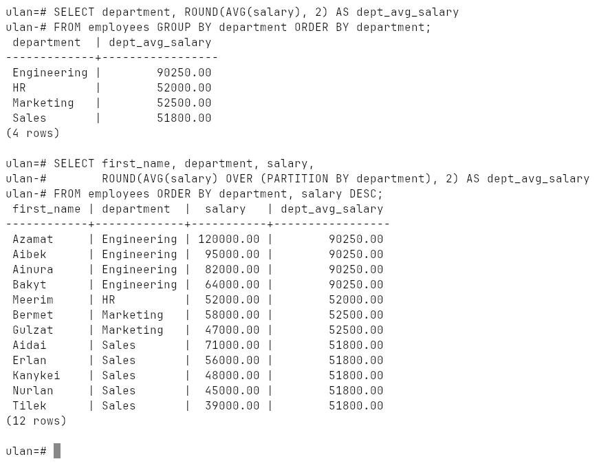
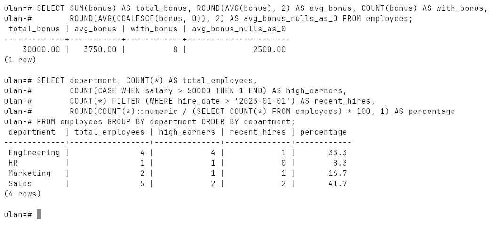

# Week 13: Aggregate Functions

`COUNT`, `SUM`, `AVG`, `MIN`, `MAX`, `STRING_AGG`, `ARRAY_AGG`, `STDDEV`,
`VARIANCE`, `CORR`, `GROUP BY` (one column, several columns, expressions),
`HAVING`, window functions vs aggregates, `NULL` handling, conditional
aggregation with `CASE` and `FILTER`, and percentages.

Run on PostgreSQL 18.6 (Windows 10, EDB installer, port `1569`).

## How to run

```bash
psql -h localhost -p 1569 -U ulan -d ulan -f lab.sql
```

[`lab.sql`](lab.sql) builds `employees` (12 rows, some with no e-mail or no
bonus), `employee_skills`, `products`, `product_reviews` and `sales`, and drops
them at the end. Transcript: [`output.txt`](output.txt), screenshots:
[`screenshots/`](screenshots).

## The basic five

| | |
|---|---|
| `COUNT(*)` | rows, including NULLs |
| `COUNT(col)` | non-NULL values |
| `COUNT(DISTINCT col)` | distinct non-NULL values |
| `SUM`, `AVG` | total, mean |
| `MIN`, `MAX` | extremes |



## STRING_AGG and ARRAY_AGG

Many rows collapse into one string or one array, optionally ordered:



## Statistics

`STDDEV` and `VARIANCE` per department, and `CORR(experience_years, salary)`
= `0.490`: a positive correlation — more experience tends to mean a higher
salary, but far from strictly.



## GROUP BY

By one column, by two (year and quarter), and by an expression (age groups).
A selected column that is neither grouped nor aggregated is an error —
PostgreSQL cannot know which `first_name` of the group to show:





## HAVING

`WHERE` filters rows **before** grouping, `HAVING` filters groups **after**.
Only the laptop has more than 10 reviews averaging above 4.0 (`4.58` from
`12` reviews); the phone has 10 reviews but averages 3.9.



## Window function vs aggregate

The aggregate returns one row per department; the window function
`AVG(salary) OVER (PARTITION BY department)` keeps every employee and puts the
department average next to them:



## NULLs and conditional aggregation

`SUM`, `AVG`, `MIN`, `MAX` skip `NULL`. Four of twelve employees have no bonus,
so `AVG(bonus)` divides by 8 (`3750.00`); treating a missing bonus as 0 with
`COALESCE` gives `2500.00`.

Counting by condition — `COUNT(CASE WHEN ... THEN 1 END)` or the cleaner
`COUNT(*) FILTER (WHERE ...)` — and each department's share of all employees:


