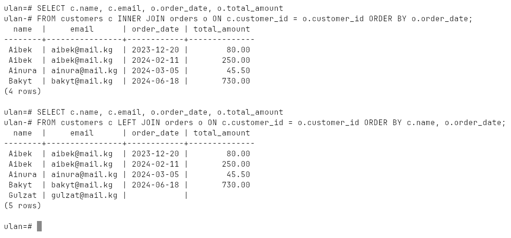
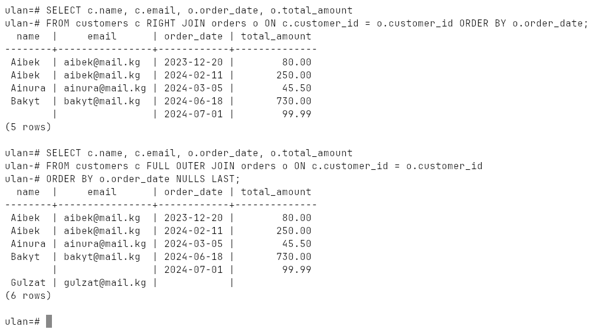
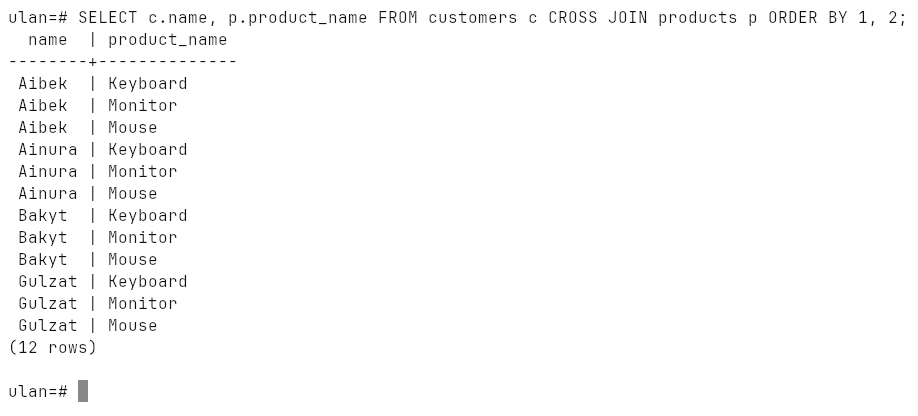
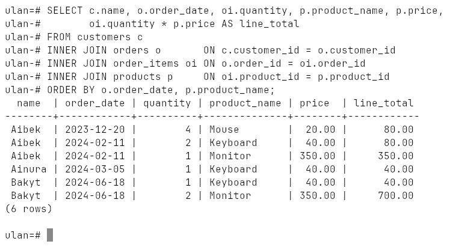
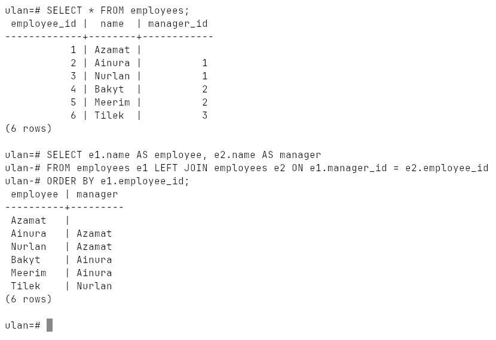
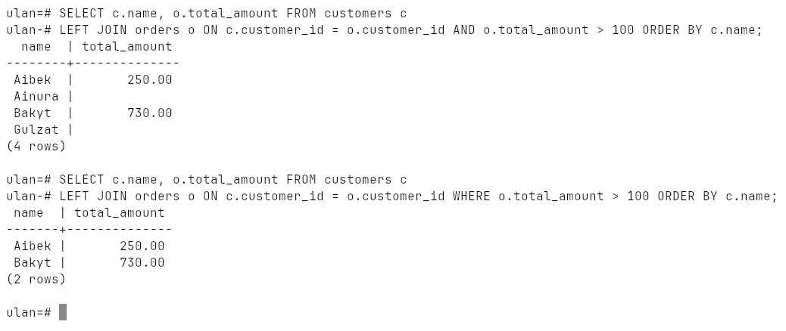
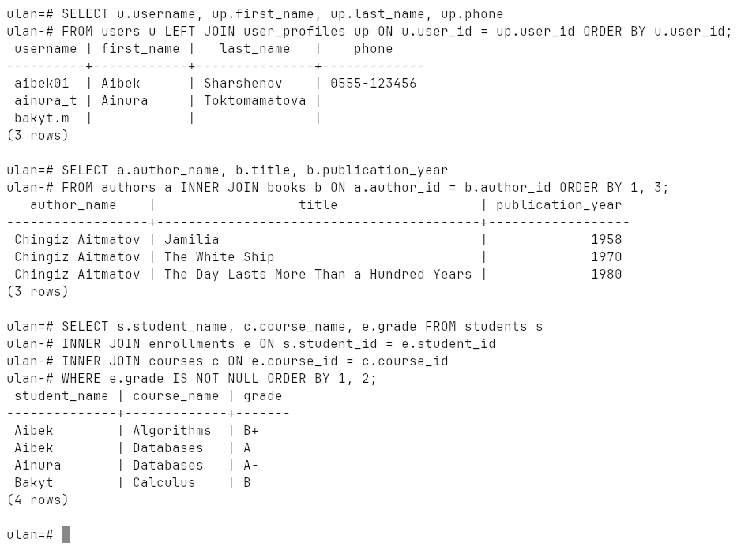
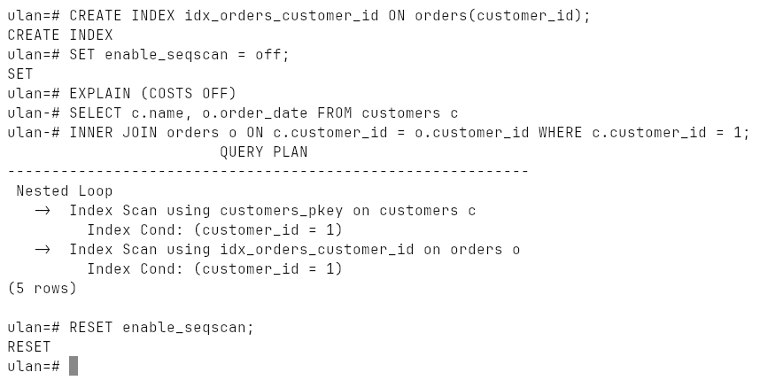
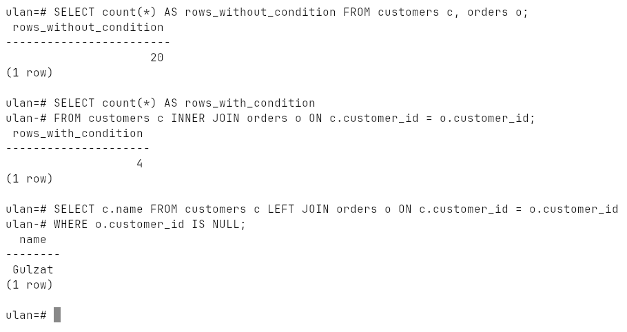

# Week 14: Joining Tables

`INNER`, `LEFT`, `RIGHT`, `FULL OUTER` and `CROSS JOIN`, joining many tables,
self joins, extra join conditions (and why `ON` ≠ `WHERE` for outer joins),
joins over 1:1, 1:N and M:N relationships, indexes on join columns, and the
usual pitfalls.

Run on PostgreSQL 18.6 (Windows 10, EDB installer, port `1569`).

## How to run

```bash
psql -h localhost -p 1569 -U ulan -d ulan -f lab.sql
```

Everything is in [`lab.sql`](lab.sql); it cleans up after itself.
Transcript: [`output.txt`](output.txt), screenshots: [`screenshots/`](screenshots).

## The data

Four customers and five orders, chosen so every join type shows a
difference:

* **Gulzat** never ordered — only on the customers side;
* order **5** has no customer (`customer_id IS NULL`) — only on the orders side.

## The five join types

| Join | Returns |
|---|---|
| `INNER JOIN` | only matching pairs — 4 rows |
| `LEFT JOIN` | every customer; NULLs where there is no order — Gulzat appears |
| `RIGHT JOIN` | every order; NULLs where there is no customer — order 5 appears |
| `FULL OUTER JOIN` | both — Gulzat **and** order 5 |
| `CROSS JOIN` | every customer with every product — 4 × 3 = 12 rows |







## More than two tables

customers → orders → order_items → products, with the line total computed:



## Self join

`employees.manager_id` points at `employees.employee_id`. Joining the table to
itself under two aliases lists everyone with their manager; the `LEFT JOIN`
keeps the CEO, who has none:



## A condition in ON vs in WHERE

With an outer join they are not the same:

* in `ON` — the condition decides which orders are attached; all 4 customers
  stay, some with `NULL`;
* in `WHERE` — it runs after the join and throws the `NULL` rows away; the
  `LEFT JOIN` effectively becomes an `INNER JOIN`.



## By relationship type

* **1:1** `users` ↔ `user_profiles` — `LEFT JOIN` keeps users without a profile;
* **1:N** `authors` → `books` — the author repeats on every book;
* **M:N** `students` ↔ `courses` — always through the junction table `enrollments`.



## Indexes on join columns

PostgreSQL indexes primary keys automatically but **not** foreign keys. The
lab adds indexes on `orders(customer_id)` and both columns of `order_items`.
With five rows the planner would still read the whole table, so the plan is
shown with sequential scans switched off:



## Pitfalls

* a missing join condition is a **Cartesian product**: 4 × 5 = 20 rows
  instead of 4;
* to find rows with **no** match, `LEFT JOIN` and keep `WHERE right.key IS NULL`
  (an anti-join) — that is how Gulzat is found.


