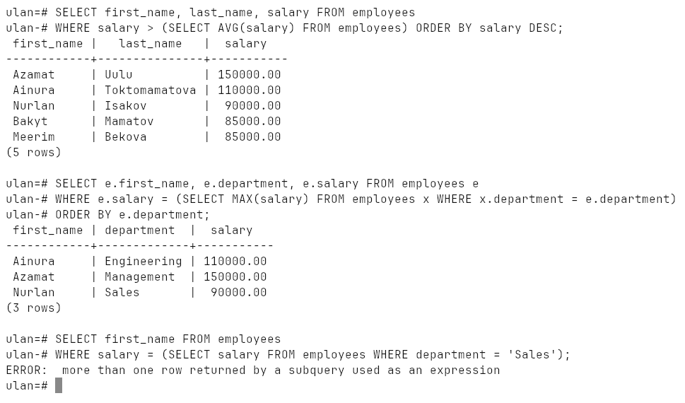
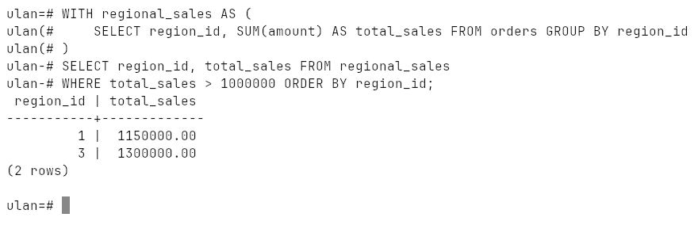
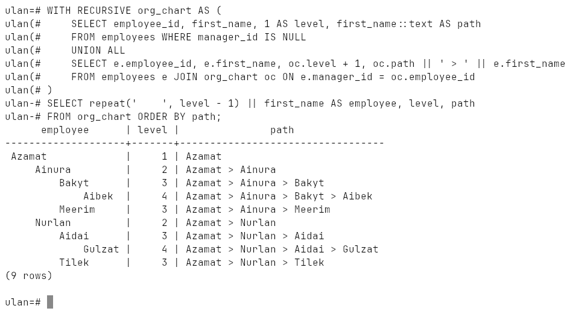
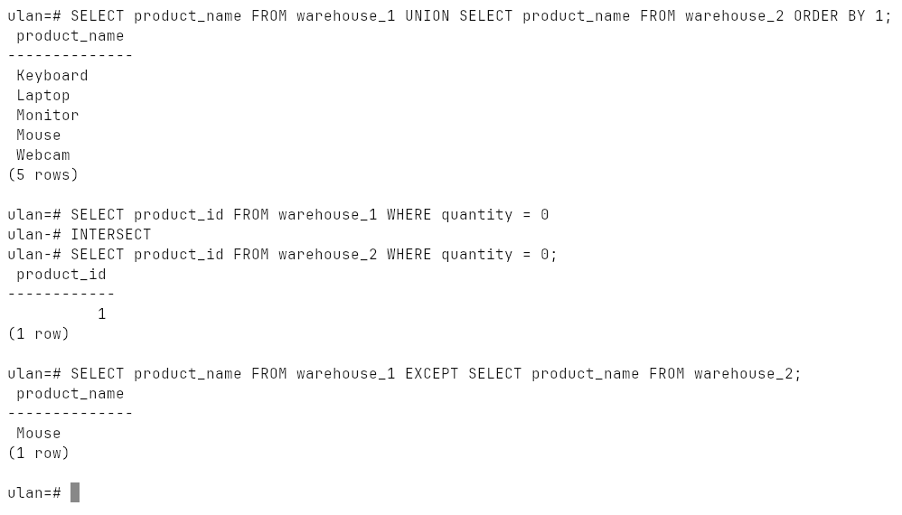
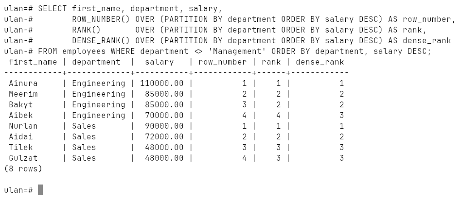
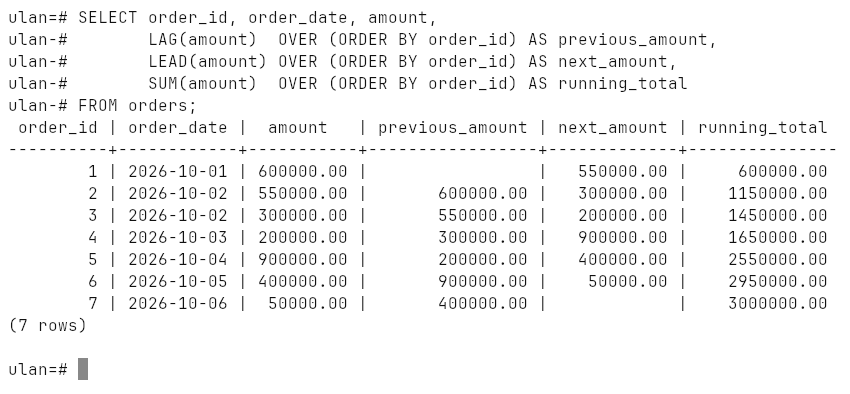
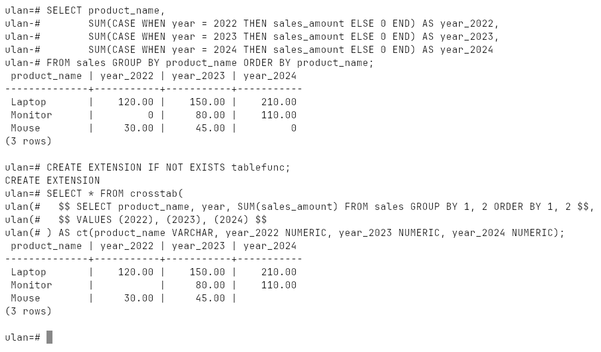
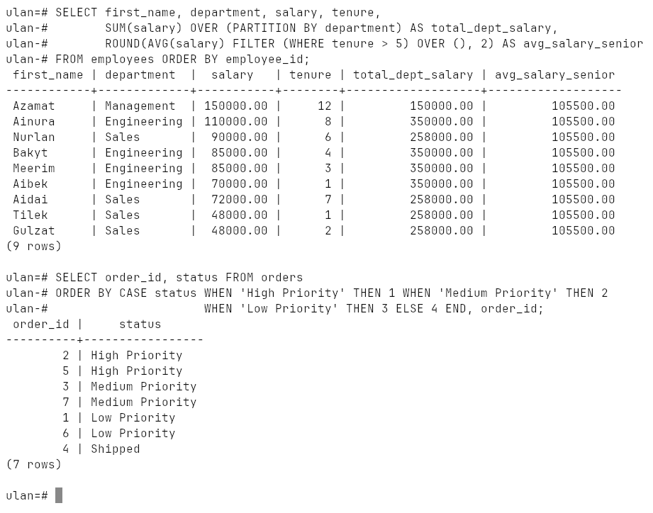
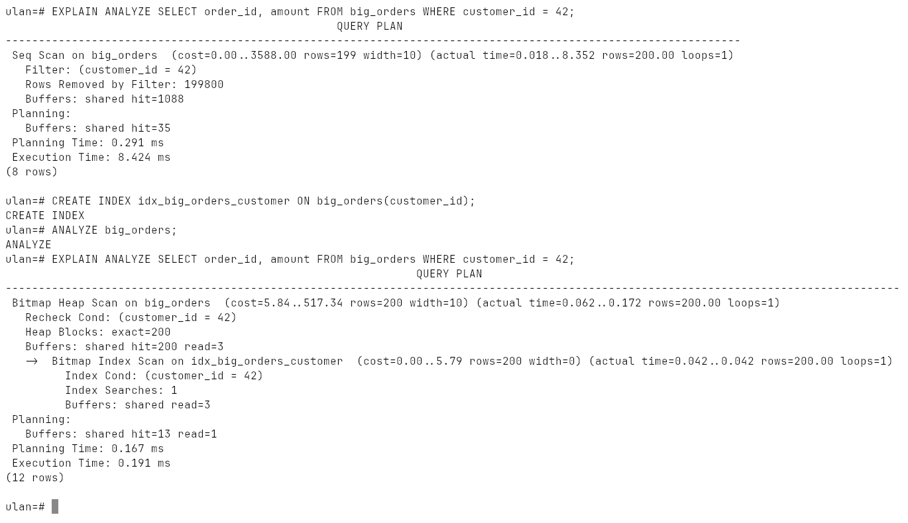

# Week 15: Advanced Querying

Subqueries (scalar, row, table, correlated), CTEs, recursive CTEs, set
operations, window functions, pivot / unpivot, `FILTER`, custom sort order,
and `EXPLAIN` / `EXPLAIN ANALYZE`.

Run on PostgreSQL 18.6 (Windows 10, EDB installer, port `1569`).

## How to run

```bash
psql -h localhost -p 1569 -U ulan -d ulan -f lab.sql
```

Everything is in [`lab.sql`](lab.sql); it cleans up after itself.
Transcript: [`output.txt`](output.txt), screenshots: [`screenshots/`](screenshots).

## Subqueries

| Type | Returns | Used with |
|---|---|---|
| scalar | one value | `=`, `>`, `<`, in the `SELECT` list |
| row | one row, several columns | `(a, b) = (SELECT ...)` |
| table | a result set | `IN`, `EXISTS`, `FROM` |
| correlated | re-run for every outer row | refers to the outer query |

Above the company average, the top earner of each department (correlated),
and what happens when a "scalar" subquery returns several rows:



## CTEs

`WITH regional_sales AS (...)` names the per-region totals; the main query
just filters them. Several CTEs can be chained, each using the previous one.



## Recursive CTE

An **anchor** (the CEO, `manager_id IS NULL`) plus a **recursive** part that
adds everyone reporting to someone already found, until nothing new appears.
Carrying the level and the path along gives the whole org chart:

```
      employee      | level |               path
--------------------+-------+----------------------------------
 Azamat             |     1 | Azamat
     Ainura         |     2 | Azamat > Ainura
         Bakyt      |     3 | Azamat > Ainura > Bakyt
             Aibek  |     4 | Azamat > Ainura > Bakyt > Aibek
         Meerim     |     3 | Azamat > Ainura > Meerim
     Nurlan         |     2 | Azamat > Nurlan
         Aidai      |     3 | Azamat > Nurlan > Aidai
             Gulzat |     4 | Azamat > Nurlan > Aidai > Gulzat
         Tilek      |     3 | Azamat > Nurlan > Tilek
```



## Set operations

| | |
|---|---|
| `UNION` | both, duplicates removed |
| `UNION ALL` | both, duplicates kept (faster) |
| `INTERSECT` | only in both — out of stock in **both** warehouses: Laptop |
| `EXCEPT` | in the first but not the second — Mouse |



## Window functions

Unlike `GROUP BY` they keep every row. Bakyt and Meerim earn the same, which
shows the difference between the three ranking functions: `ROW_NUMBER` 2 and
3, `RANK` 2 and 2 then **4**, `DENSE_RANK` 2 and 2 then **3**.



`LAG` / `LEAD` look at the previous / next row, `SUM() OVER (ORDER BY ...)` is
a running total:



## Pivot and unpivot

PostgreSQL has no `PIVOT` keyword. Years become columns with conditional
aggregation, or with `crosstab()` from the `tablefunc` extension — note that
`crosstab` leaves `NULL` where the `CASE` version puts `0`. `UNION ALL` turns
the columns back into rows.



## FILTER and custom sorting

`AVG(salary) FILTER (WHERE tenure > 5) OVER ()` — the average of the senior
employees, next to every row. `ORDER BY CASE status WHEN 'High Priority' THEN 1 ...`
sorts by business priority instead of alphabetically.



## EXPLAIN ANALYZE

200 000 orders, looking up one customer:

| | plan | rows read | execution |
|---|---|---|---|
| no index | `Seq Scan` | all 200 000 (199 800 removed by the filter) | 6–8 ms |
| index on `customer_id` | `Bitmap Index Scan` + `Bitmap Heap Scan` | the 200 matching | ~0.2 ms |



`EXPLAIN` alone only shows the plan; `EXPLAIN ANALYZE` actually runs the query
and adds the real times and row counts. Other habits from the lecture: select
only the columns you need, prefer `UNION ALL` when duplicates are impossible,
and `LIMIT` while developing a query.
