# Week 16: Transactions and ACID Properties

`BEGIN` / `COMMIT` / `ROLLBACK`, the four ACID properties on a bank transfer,
all four isolation levels shown with a **real second session**, savepoints,
error handling in PL/pgSQL, and finding blocked transactions.

Run on PostgreSQL 18.6 (Windows 10, EDB installer, port `1569`).

## How to run

```bash
psql -h localhost -p 1569 -U ulan -d ulan -f lab.sql
```

Everything is in [`lab.sql`](lab.sql); it cleans up after itself.
Transcript: [`output.txt`](output.txt), screenshots: [`screenshots/`](screenshots).

Isolation can only be seen with two transactions running at the same time.
The second (and third) session is opened with the `dblink` extension — a
separate connection with its own backend process, driven from the same
script. The connection needs the password, which is read from `PGPASSWORD`
with `\getenv` and never written into a file.

## COMMIT and ROLLBACK

`COMMIT` makes both halves of the transfer permanent; after `ROLLBACK` the
balances are exactly as before `BEGIN`. The prompt shows the state:
`ulan=*#` inside a transaction, `ulan=!#` in a failed one.

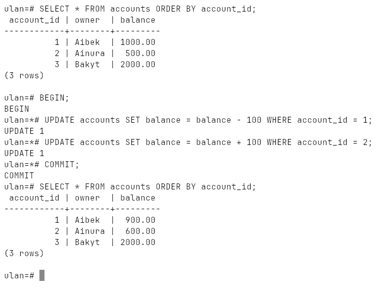

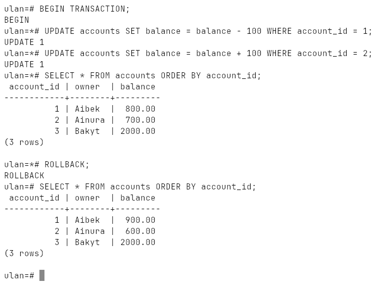

## Atomicity

The order wants 2 items, only 1 is in stock. The stock update breaks
`CHECK (stock >= 0)`; every statement after it is refused
(`current transaction is aborted`), and `COMMIT` turns into `ROLLBACK`. The
order inserted **before** the error is gone too — 0 orders saved:

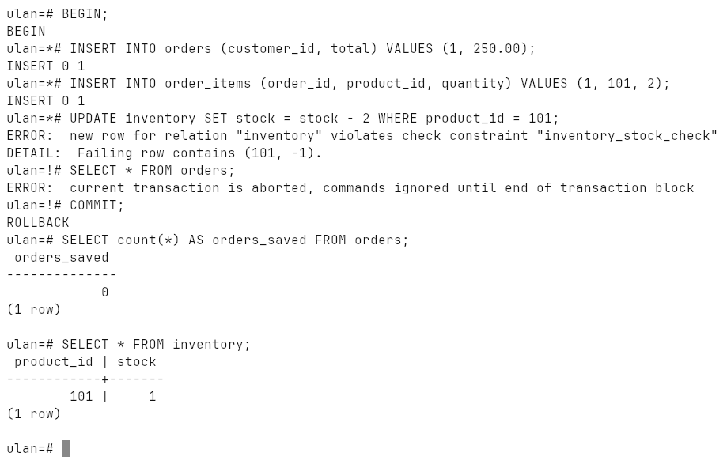

Without a transaction the same three statements leave half an order behind
(`orders_saved_without_transaction = 1`, in the transcript).

## Consistency

A transfer of 5000 from an account holding 400 would break
`CHECK (balance >= 0)`. The whole transfer is refused, including the
+5000 that already succeeded on the other account:

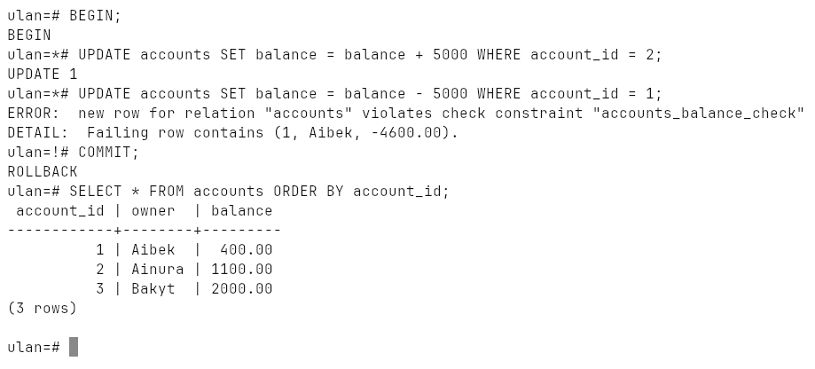

## Isolation

| Level | Dirty read | Non-repeatable read | Phantom read | In PostgreSQL |
|---|---|---|---|---|
| READ UNCOMMITTED | possible by the standard | possible | possible | behaves as READ COMMITTED |
| READ COMMITTED (default) | no | **yes** | **yes** | |
| REPEATABLE READ | no | no | possible by the standard | no phantoms either (snapshot) |
| SERIALIZABLE | no | no | no | also detects write skew |

**No dirty reads.** The other session sets account 3 to 0 without committing;
even at `READ UNCOMMITTED` we still see 2000:

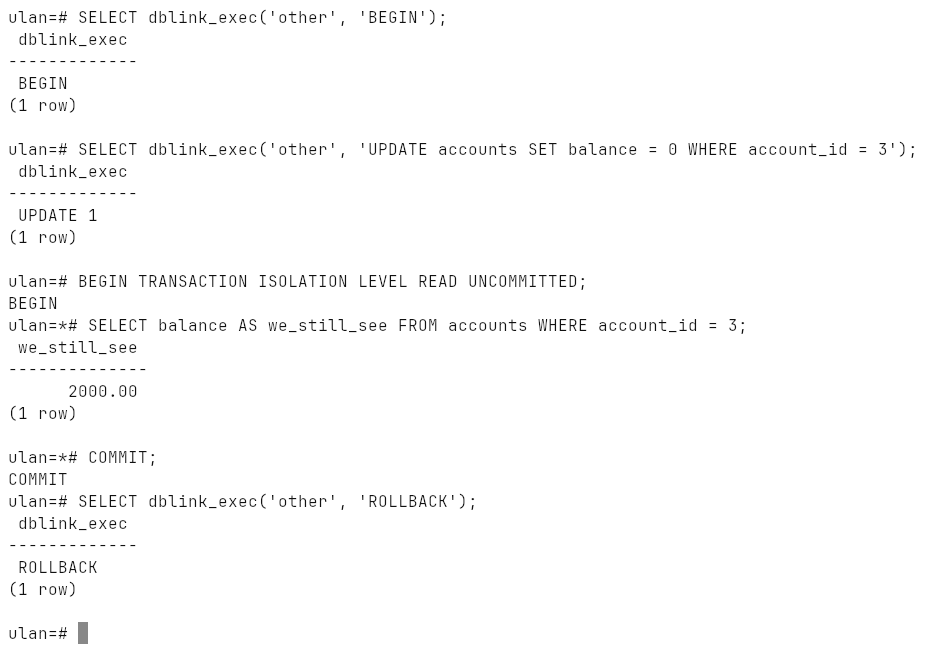

**Non-repeatable read.** Under `READ COMMITTED` the same `SELECT` returns
2000.00 and then 2001.00 inside one transaction, because the other session
committed in between. Under `REPEATABLE READ` both reads return the same
value — the transaction works on a snapshot — and trying to update the row
the other session changed fails with
`could not serialize access due to concurrent update`:

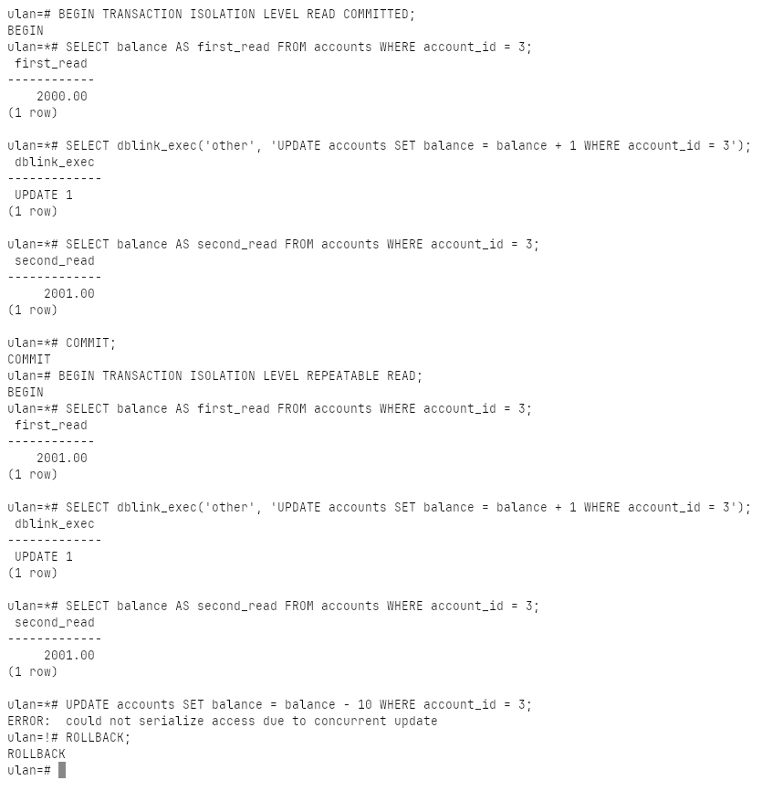

**Phantom rows.** The other session inserts a new rich account. `READ
COMMITTED` counts 2, then 3; `REPEATABLE READ` counts 2 and 2:

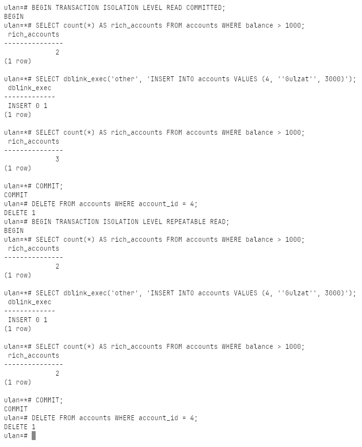

**SERIALIZABLE and write skew.** Rule: accounts 1 and 2 together keep at
least 500 (they hold 400 + 1100 = 1500). Both sessions read the sum, both see
1500, and each withdraws from a *different* account — 900 and 300. Either one
alone would be fine; together they would leave 300. No row is written by
both, so `REPEATABLE READ` would let it through; `SERIALIZABLE` cancels the
second one:

```
ERROR:  could not serialize access due to read/write dependencies among transactions
DETAIL:  Reason code: Canceled on identification as a pivot, during write.
HINT:  The transaction might succeed if retried.
```

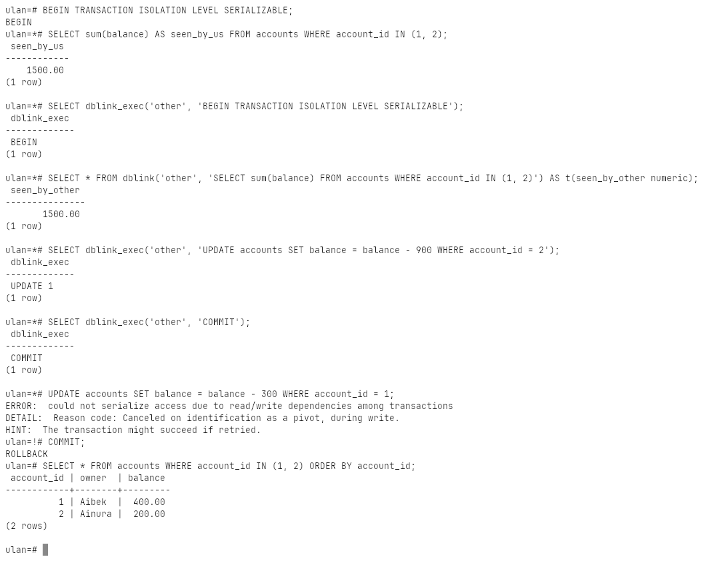

## Durability

`COMMIT` returns only after the commit record is written to the WAL on disk
(`synchronous_commit = on`, `fsync = on`); the lab shows the WAL position
moving forward with the commit. After a crash the server replays the WAL.

## Savepoints

A failed statement can be undone back to a savepoint without losing the
whole transaction: the invalid product (negative price) is rolled back to
`sp2`, and Laptop, Mouse and Keyboard are committed:

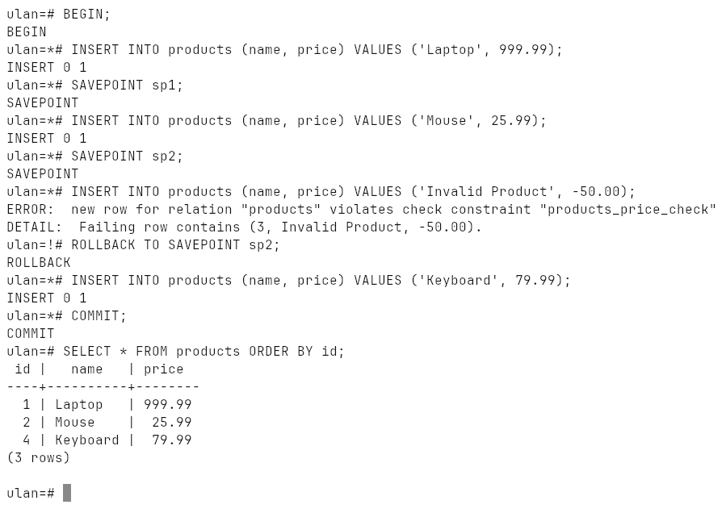

`RELEASE SAVEPOINT` forgets a savepoint; rolling back to it afterwards is an
error.

## Error handling in PL/pgSQL

The lecture's example calls `ROLLBACK` inside the `EXCEPTION` block of a `DO`
statement, which PostgreSQL does not allow. The block does not need it: an
`EXCEPTION` section already undoes everything the block did before the error.
The +100 on account 1 is gone, only the `NOTICE` remains:

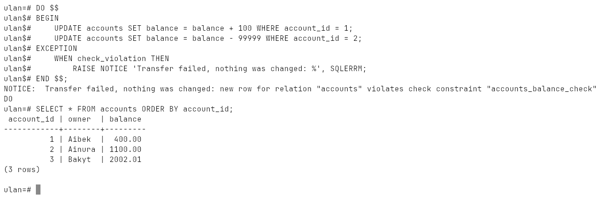

`RAISE EXCEPTION 'Insufficient funds: ...'` aborts the block and undoes its
changes the same way.

## Monitoring locks

One session updates account 1 and keeps its transaction open, a second one
tries to update the same row and waits. `pg_blocking_pids()` shows who waits
for whom; after the first session commits, the waiting `UPDATE` finishes:

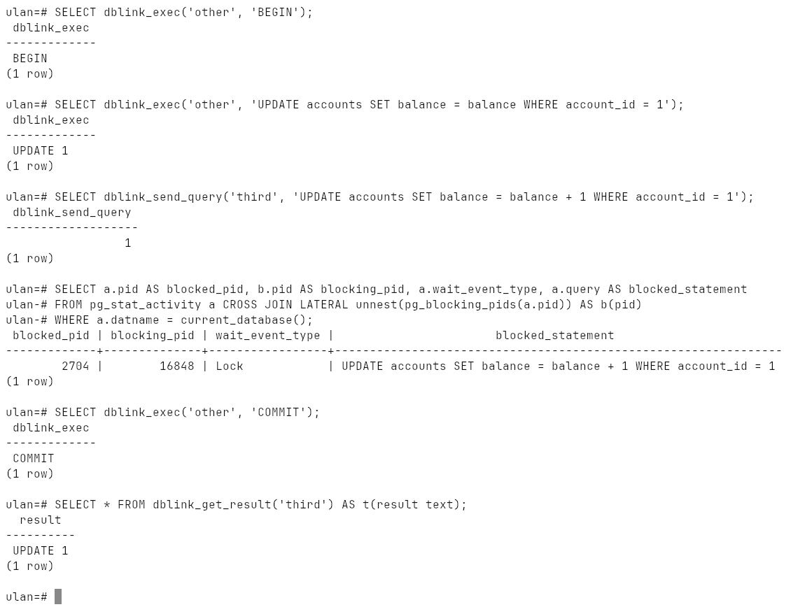

## Best practices

* keep transactions short — locks are held until the end;
* group related statements in one explicit transaction instead of relying on
  autocommit;
* `SERIALIZABLE` (with retries) for money, `READ COMMITTED` for reports;
* savepoints for steps that may fail without spoiling the rest.
