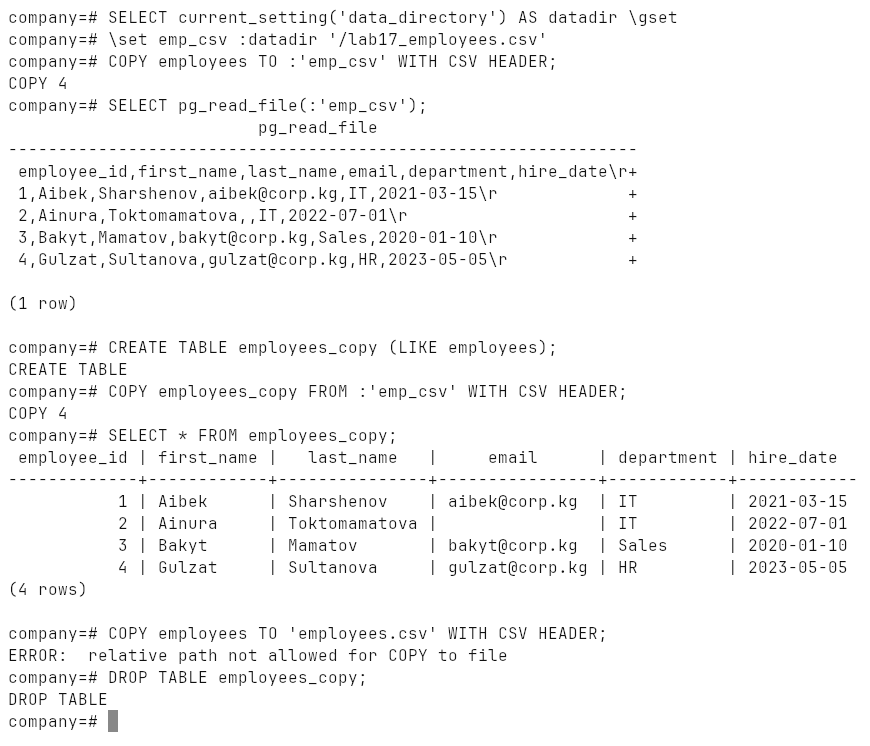
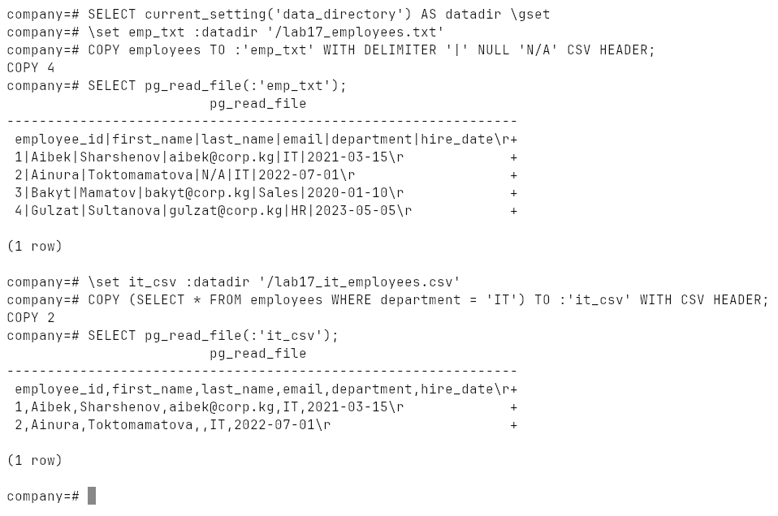
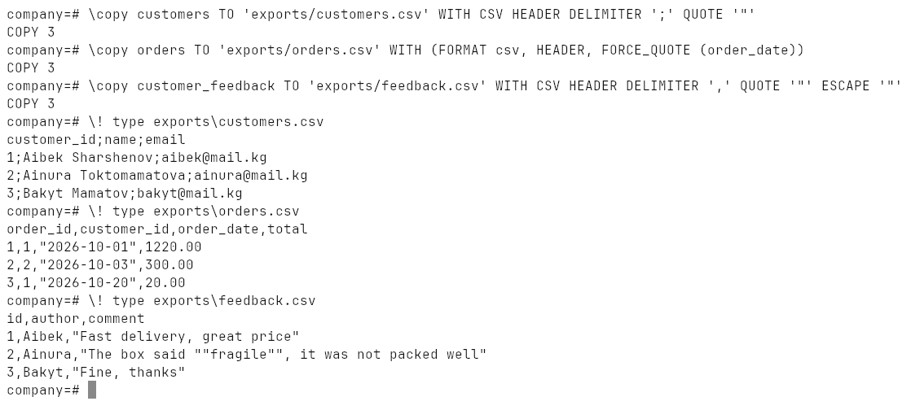
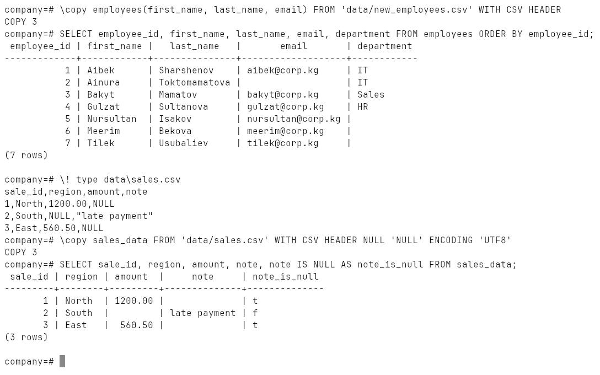
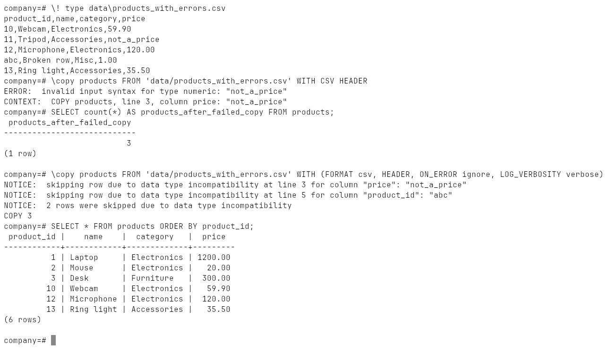
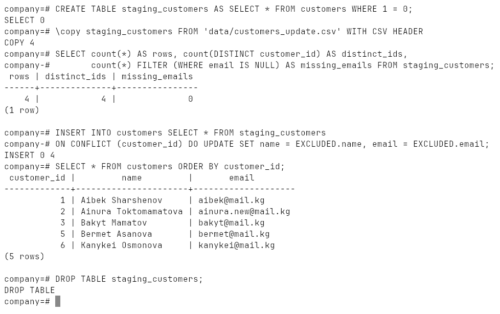
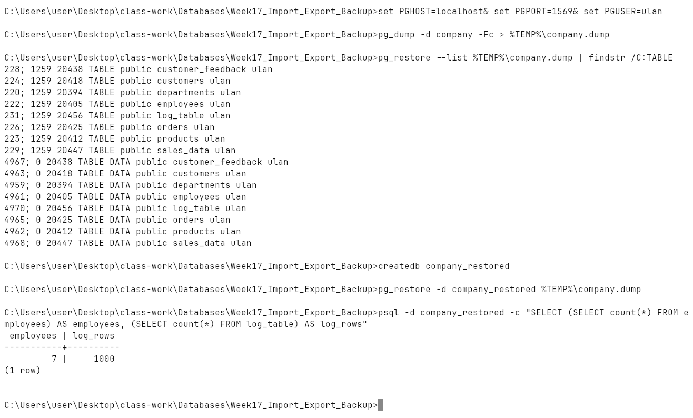
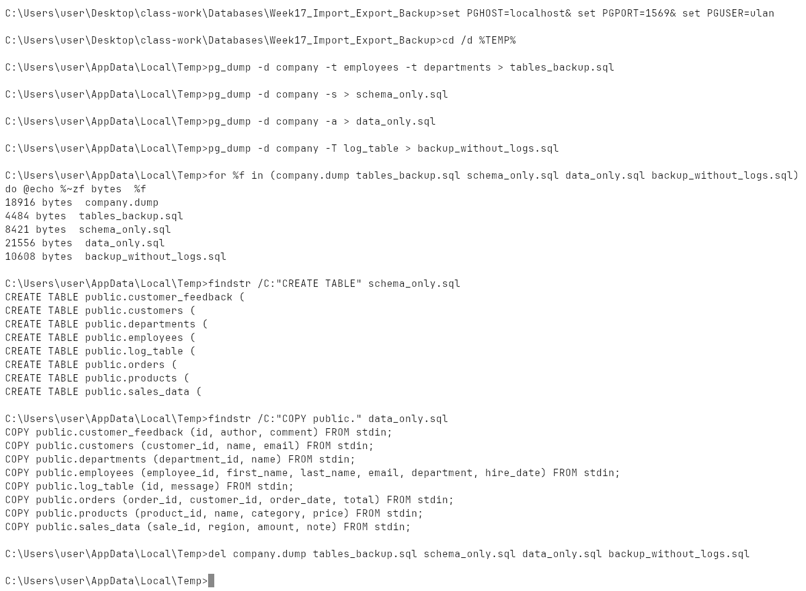
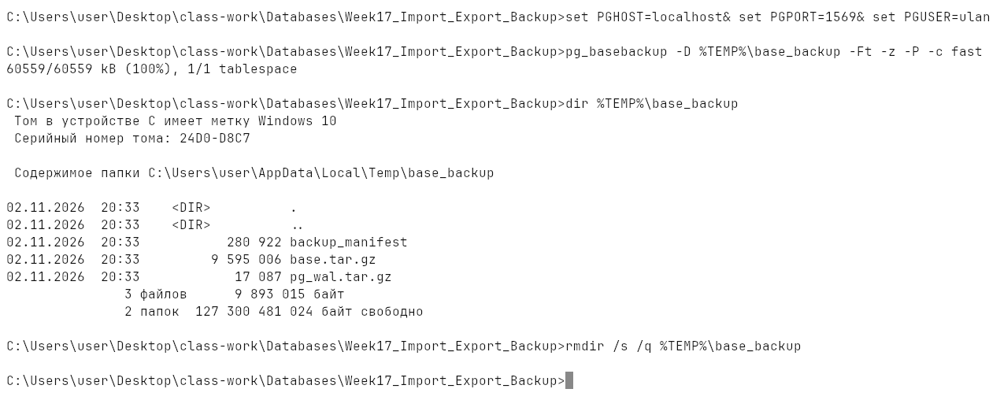
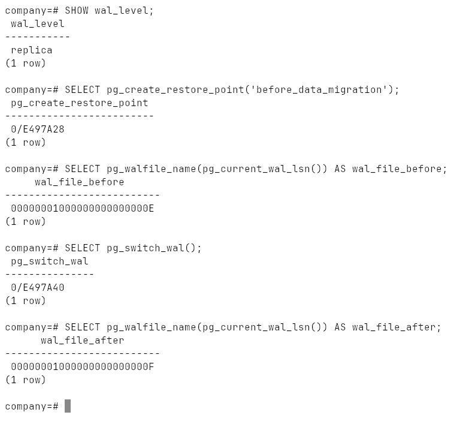

# Week 17: Data Import/Export and Backup

`COPY` and `\copy` with all the CSV options, skipping bad rows, an ETL load
through a staging table, `pg_dump` / `pg_restore` in every form from the
lecture, `pg_dumpall`, `pg_basebackup`, WAL and restore points.

Run on PostgreSQL 18.6 (Windows 10, EDB installer, port `1569`); the backup
part in Git Bash.

## How to run

From this folder:

```bash
psql -h localhost -p 1569 -U ulan -d ulan -f lab.sql   # part 1: COPY, builds database "company"
bash backup.sh                                          # part 2: backups of "company", then drops it
```

| File | |
|---|---|
| [`lab.sql`](lab.sql), [`output.txt`](output.txt) | part 1 and its transcript |
| [`backup.sh`](backup.sh), [`backup_output.txt`](backup_output.txt) | part 2 and its transcript |
| [`data/`](data) | input CSV files |
| [`exports/`](exports) | files written by `\copy ... TO` |
| [`backups/`](backups) | the dumps made by `backup.sh` |
| [`screenshots/`](screenshots) | |

## COPY — on the server

`COPY` runs inside the server process, so the path is on the **server's**
disk, it must be absolute, and the server's OS account must be able to write
there. On Windows the service runs as `NETWORK SERVICE`, which can always
write to its own data directory, so the files go there. `pg_read_file` reads
them back:



Custom delimiter and NULL marker, and the result of a query instead of a
table:



## \copy — on the client

`\copy` has the same options, but `psql` reads / writes the file and streams
it over the connection, so relative paths and ordinary user permissions work.

| Option | Effect, in [`exports/`](exports) |
|---|---|
| `DELIMITER ';' QUOTE '"'` | [`customers.csv`](exports/customers.csv) separated by `;` |
| `FORCE_QUOTE (order_date)` | [`orders.csv`](exports/orders.csv) — every date quoted |
| `QUOTE '"' ESCAPE '"'` | [`feedback.csv`](exports/feedback.csv) — `"fragile"` inside a value becomes `""fragile""`, values with commas are quoted |



Importing only some columns (the rest get their defaults), and a file where
the word `NULL` means SQL `NULL`:



## Bad rows

[`products_with_errors.csv`](data/products_with_errors.csv) has a price
`not_a_price` and an id `abc`. By default one bad row aborts the whole `COPY`
and **nothing** is loaded. PostgreSQL 17+ can skip them with
`ON_ERROR ignore`; `LOG_VERBOSITY verbose` says which rows were dropped:



## ETL through a staging table

Extract (`\copy (SELECT ... LIMIT ... OFFSET ...) TO`), load into an empty
`staging_customers`, validate (no duplicate ids, no missing e-mails), then
merge with `INSERT ... ON CONFLICT DO UPDATE` — Ainura's e-mail is updated,
Bermet and Kanykei are added:



## pg_dump and pg_restore

All the lecture's variants are in [`backup.sh`](backup.sh); the files are in
[`backups/`](backups):

| Command | File |
|---|---|
| `pg_dump -d company > company.sql` | plain SQL script |
| `pg_dump -d company -Fc > company.dump` | custom format, compressed, for `pg_restore` |
| `pg_dump -t employees -t departments` | `tables_backup.sql` |
| `pg_dump -s` / `pg_dump -a` | `schema_only.sql` / `data_only.sql` |
| `pg_dump -T log_table` | `backup_without_logs.sql` — 0 `log line` rows vs 1000 |
| `pg_dump -Fc -O` | `backup_no_owner.dump` |
| `pg_dumpall --globals-only --no-role-passwords` | `globals.sql` — roles, no password hashes |

`pg_restore --list` checks the archive; then a full restore into a new
database, a restore of a single table (`-t employees`), and a parallel restore
(`-j 4`). The row counts of the copies match the original:

```
company|7|5|1000
company_restored|7|5|1000
company_parallel|7|5|1000
```





## Full and incremental backups, PITR

`pg_dump` is a **logical** backup of one database. A **physical** backup of
the whole cluster is `pg_basebackup`, which together with archived WAL files
is the basis for incremental backups and point-in-time recovery (`-c fast`
asks for an immediate checkpoint instead of waiting for the next scheduled
one):



The server runs with `wal_level = replica` (enough for base backups and
replication) and `archive_mode = off`. Turning archiving on is a
`postgresql.conf` change plus a restart:

```
wal_level = replica
archive_mode = on
archive_command = 'copy "%p" "D:\\pg_wal_archive\\%f"'   # Windows form of cp %p /backup/wal/%f
```

A named restore point is what `recovery_target_name` can stop at, and
`pg_switch_wal()` closes the current WAL segment so it can be archived:



Recovery to a point in time: stop the server, replace the data directory with
the base backup, set `restore_command` and `recovery_target_time` (or
`recovery_target_name = 'before_data_migration'`), create `recovery.signal`,
start the server — it replays the archived WAL up to the target.

## Migration strategies

| Strategy | Downtime | How |
|---|---|---|
| dump and restore | yes | `pg_dump -Fc` on the source, `pg_restore` on the target |
| logical replication | minimal | `CREATE PUBLICATION` on the source, `CREATE SUBSCRIPTION` on the target |
| physical replication | ~zero | a standby created with `pg_basebackup -R`, then promoted |
| ETL pipeline | depends | batches of `COPY`, staging tables, `ON CONFLICT` merge (shown above) |
