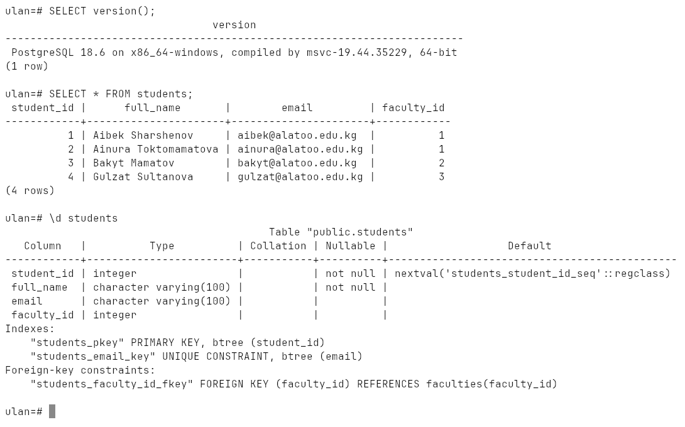
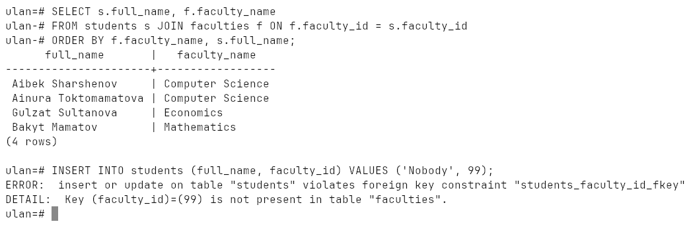
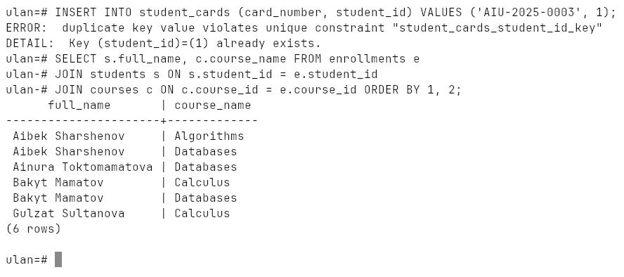
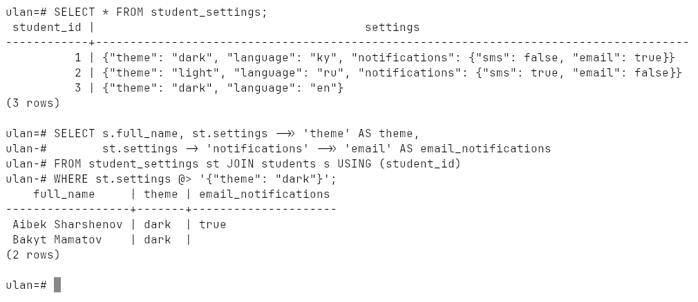
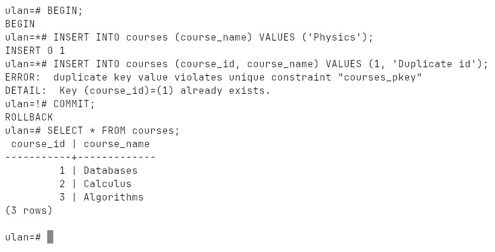

# Week 1: Introduction to Relational Databases

Database vs DBMS, tables / rows / columns, primary and foreign keys, schema,
query, index, normalization, the three relationship types, PostgreSQL as a
document store, and a first look at ACID.

Run on PostgreSQL 18.6 (Windows 10, EDB installer, port `1569`).

## How to run

```bash
psql -h localhost -p 1569 -U ulan -d ulan -f lab.sql
```

Everything is in [`lab.sql`](lab.sql); it drops its tables at the start and at
the end, so it can be run again. The full transcript of a run is in
[`output.txt`](output.txt), screenshots are in [`screenshots/`](screenshots).

## Database and DBMS

A **database** is an organized collection of structured data. A **DBMS** is
the software that manages it and lets users create, read, update and delete
(CRUD) the data — PostgreSQL, MySQL, Oracle, MS SQL Server. The lab talks to
one:

```
SELECT version();
 PostgreSQL 18.6 on x86_64-windows, compiled by msvc-19.44.35229, 64-bit
```

## Core concepts on a real table

| Term | In the lab |
|---|---|
| **Table** | `students` — one kind of entity |
| **Row** | one student |
| **Column** | `full_name`, `email`, … — one attribute every row has |
| **Primary key** | `student_id` — unique, never NULL |
| **Foreign key** | `faculty_id` → `faculties(faculty_id)` |
| **Schema** | the blueprint `\d students` prints |
| **Index** | `students_pkey`, `students_email_key` — built automatically |



A **query** is a question in SQL. The foreign key is what lets the two tables
be joined back together, and it refuses a faculty that does not exist:

```
INSERT INTO students (full_name, faculty_id) VALUES ('Nobody', 99);
ERROR:  insert or update on table "students" violates foreign key constraint "students_faculty_id_fkey"
DETAIL:  Key (faculty_id)=(99) is not present in table "faculties".
```



## Relationship types

| Type | Example in the lab | How it is built |
|---|---|---|
| one-to-one | student ↔ student card | FK with `UNIQUE` |
| one-to-many | faculty → students | plain FK on the "many" side |
| many-to-many | students ↔ courses | junction table `enrollments` with two FKs |

The `UNIQUE` on `student_cards.student_id` is what keeps the relationship
one-to-one — a second card for the same student is rejected:



## Normalization

The faculty name is stored once in `faculties` and referenced by id. Renaming
`Computer Science` is a single-row `UPDATE`, and every student sees the new
name — no copies to keep in sync.

## SQL vs NoSQL

NoSQL databases (MongoDB, Redis, Cassandra, Neo4j) trade the rigid schema and
strict ACID guarantees for a flexible structure and horizontal scaling.

| | SQL | NoSQL |
|---|---|---|
| structure | fixed schema | flexible / none |
| scaling | vertical | horizontal |
| guarantees | ACID | often BASE (eventual consistency) |
| language | standard SQL | system-specific APIs |

PostgreSQL covers part of both worlds: a `JSONB` column stores a document, and
it can be queried with `->`, `->>` and `@>`:



## ACID: atomicity

Two inserts in one transaction, the second fails. The first is undone too —
`COMMIT` on an aborted transaction turns into `ROLLBACK`, and `Physics` is not
in the table:



| Property | Meaning |
|---|---|
| **A**tomicity | all of the transaction or nothing |
| **C**onsistency | from one valid state to another; constraints always hold |
| **I**solation | concurrent transactions do not see each other's half-done work |
| **D**urability | once committed, it survives a crash |

## Why PostgreSQL

Started in 1986 as POSTGRES at UC Berkeley (Michael Stonebraker), SQL support
and the name PostgreSQL in 1996. Full ACID, extensible (own types, indexes,
functions), JSON / XML support, procedures in PL/pgSQL, Python, C,
replication — and open source. Compared to MySQL it is stricter about the SQL
standard, compared to Oracle it is free, and unlike SQLite it is a real
multi-user server.
