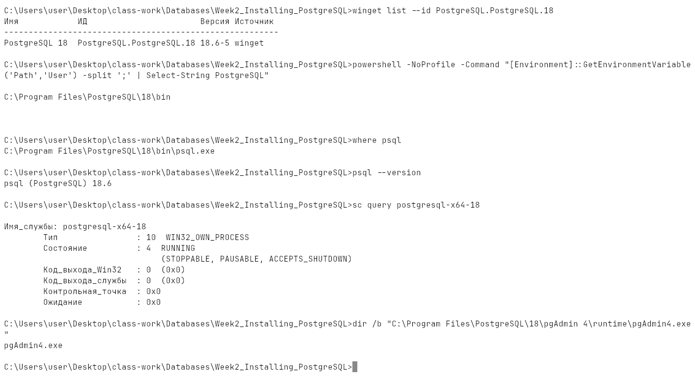
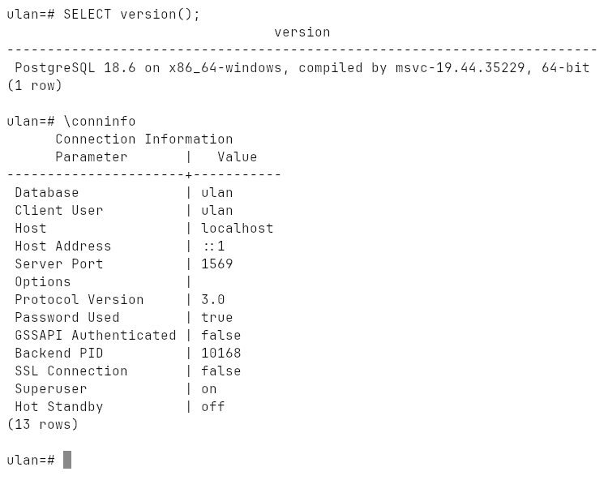
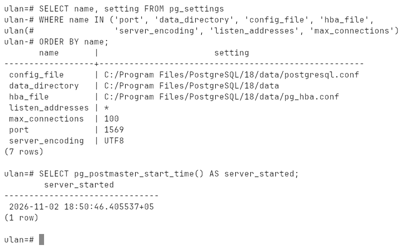
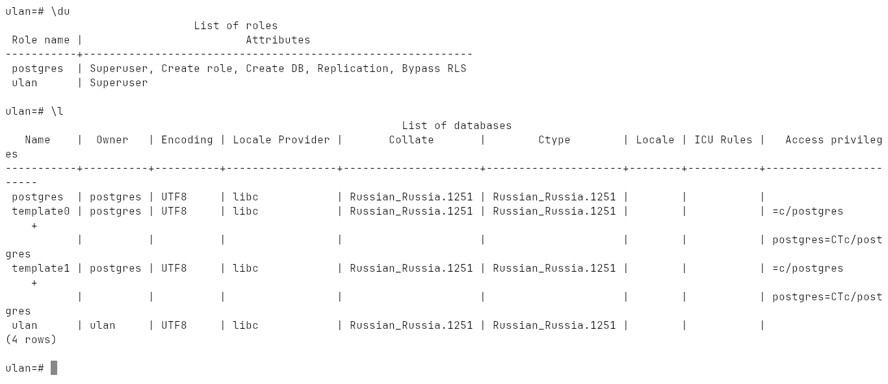
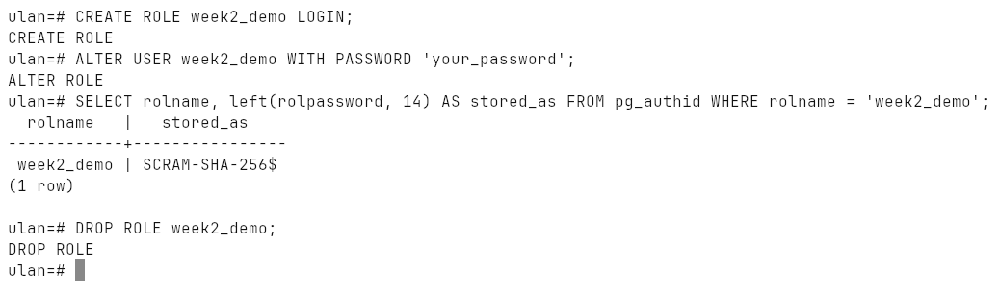

# Week 2: Installing PostgreSQL and pgAdmin

Installing the PostgreSQL 18 server (pgAdmin 4 comes with it) on Windows,
checking that it runs, and setting up the working role.

Done on Windows 10 with the EDB installer, port `1569`.

## Installation (Windows)

The lecture's steps — download the installer, run it, add `bin` to `PATH` —
done from the command line with `winget`, which downloads the same EDB
installer and runs it unattended:

```powershell
winget install --id PostgreSQL.PostgreSQL.18 -e `
  --override "--mode unattended --unattendedmodeui none --superpassword <password> --serverport 1569 --install_runtimes 0"
```

* server: `C:\Program Files\PostgreSQL\18`
* data directory: `C:\Program Files\PostgreSQL\18\data`
* Windows service `postgresql-x64-18`, started automatically
* superuser `postgres`
* pgAdmin 4: `C:\Program Files\PostgreSQL\18\pgAdmin 4` (Start menu → pgAdmin 4)
* `C:\Program Files\PostgreSQL\18\bin` added to `PATH`

Port `1569` matches the earlier labs (and avoids `5432`, already taken by an
older PostgreSQL 17 on this machine).



## Working role

The installer only creates `postgres`. The labs use the role `ulan` with its own
database, created once as `postgres`:

```sql
CREATE ROLE ulan LOGIN SUPERUSER PASSWORD '...';
CREATE DATABASE ulan OWNER ulan;
ALTER ROLE ulan SET lc_messages = 'C';   -- English server messages on a Russian Windows
```

The password is kept in `%APPDATA%\postgresql\pgpass.conf`, so `psql` does not
ask for it.

## Checking the installation

```bash
psql -h localhost -p 1569 -U ulan -d ulan -f lab.sql
```

[`lab.sql`](lab.sql) prints the version, the connection, where the data lives,
roles and databases, changes a password and stores a row. Transcript:
[`output.txt`](output.txt).







## Setting a password

The lecture's `ALTER USER ... WITH PASSWORD`, on a throwaway role so the real
password stays out of the repository. PostgreSQL never stores the password
itself, only a SCRAM-SHA-256 hash:



## Managing the server

| | Windows | Ubuntu | macOS (Homebrew) |
|---|---|---|---|
| status | `sc query postgresql-x64-18` | `sudo service postgresql status` | `brew services list` |
| start | `net start postgresql-x64-18` | `sudo service postgresql start` | `brew services start postgresql` |
| stop | `net stop postgresql-x64-18` | `sudo service postgresql stop` | `brew services stop postgresql` |
| console | `psql -U postgres` | `sudo -u postgres psql` | `psql postgres` |
