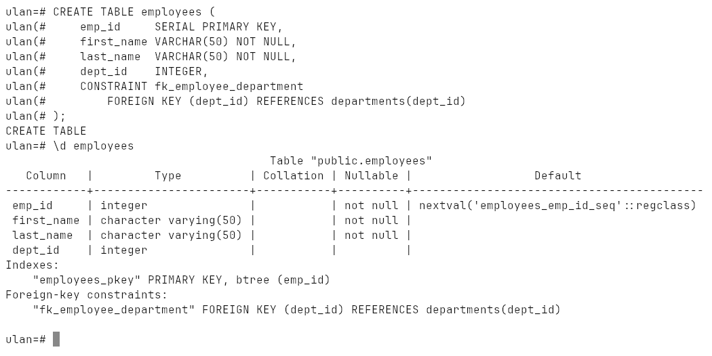
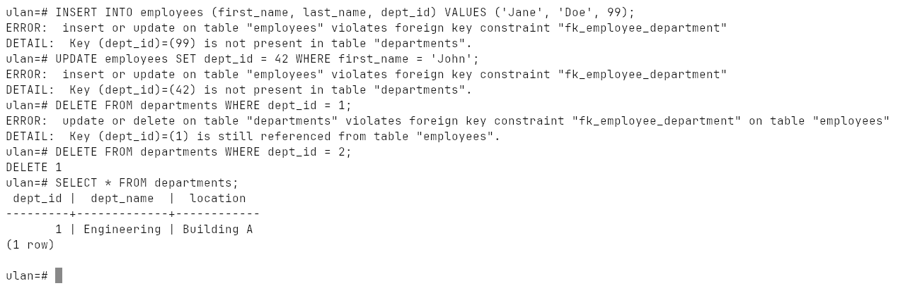
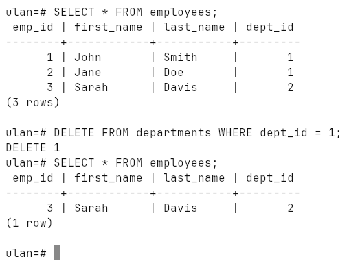
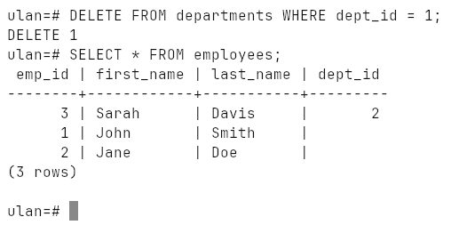
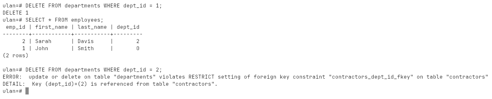
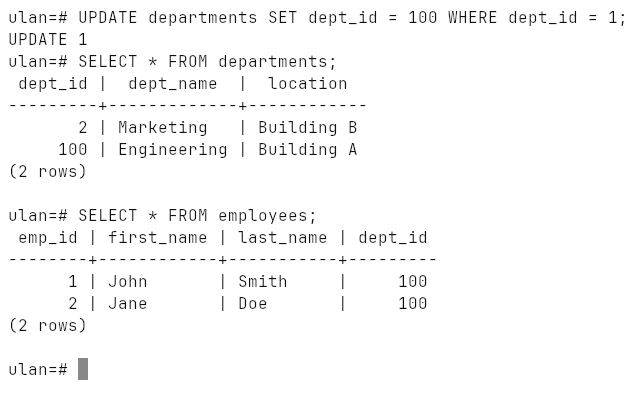
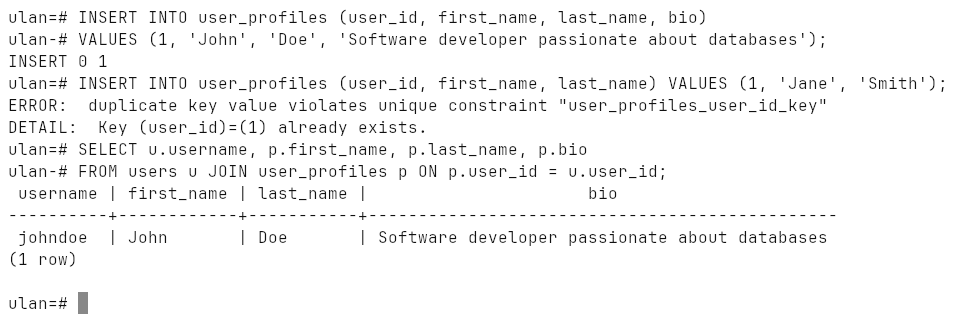
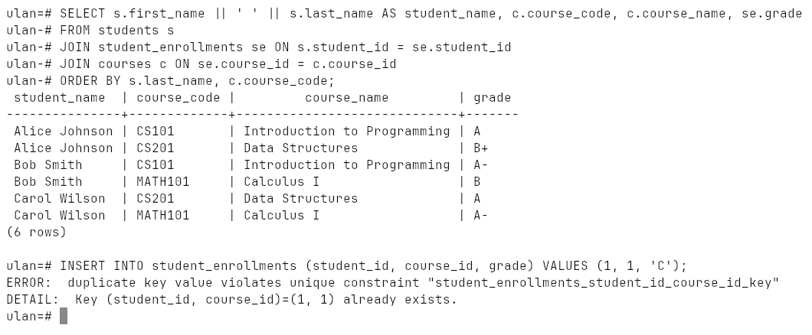

# Week 8: Foreign Keys and Relationships

The four ways to declare a foreign key, referential integrity, every
`ON DELETE` / `ON UPDATE` option, and one-to-one, one-to-many and many-to-many
relationships.

Run on PostgreSQL 18.6 (Windows 10, EDB installer, port `1569`).

## How to run

```bash
psql -h localhost -p 1569 -U ulan -d ulan -f lab.sql
```

Everything is in [`lab.sql`](lab.sql); it drops its tables at the start and at
the end, so it can be run again. Transcript: [`output.txt`](output.txt),
screenshots: [`screenshots/`](screenshots).

## Four ways to declare one

| Method | Syntax | Constraint name |
|---|---|---|
| inline | `dept_id INTEGER REFERENCES departments(dept_id)` | `employees_dept_id_fkey` (auto) |
| table-level | `FOREIGN KEY (dept_id) REFERENCES departments(dept_id)` | `employees_dept_id_fkey` (auto) |
| on an existing table | `ALTER TABLE employees ADD CONSTRAINT fk_employee_department FOREIGN KEY ...` | `fk_employee_department` |
| named at creation | `CONSTRAINT fk_employee_department FOREIGN KEY ...` | `fk_employee_department` |



## Referential integrity

Three rules, all enforced by the database itself:

| Rule | What fails |
|---|---|
| insert | an employee in department 99, which does not exist |
| update | moving an employee to department 42, which does not exist |
| delete | deleting department 1 while an employee still points at it |



Department 2, which nobody references, is deleted without complaint.

## What happens to the children

| Option | Deleting / updating the parent… |
|---|---|
| `NO ACTION` (default) | is refused while children exist |
| `RESTRICT` | is refused, checked immediately |
| `CASCADE` | deletes / updates the children too |
| `SET NULL` | sets the children's FK to `NULL` |
| `SET DEFAULT` | sets the children's FK to its `DEFAULT` |

`ON DELETE CASCADE` — John and Jane go with department 1:



`ON DELETE SET NULL` — they stay, without a department:



`ON DELETE SET DEFAULT` moves John to department `0`. The default value must
itself exist in the parent table, so an `Unassigned` department with id 0 is
created first. `RESTRICT` (on a second table, `contractors`) refuses the
delete:



`ON UPDATE CASCADE` — the department's key changes from 1 to 100 and both
employees follow:



## Relationships

**One-to-one** — a foreign key with `UNIQUE`. A user has at most one profile;
a second profile for user 1 breaks the unique constraint:



The other way to build it is to share the key: `user_profiles.user_id` is both
the primary key and the foreign key.

**One-to-many** — the most common case: a plain foreign key on the "many" side
(`employees.dept_id`, `comments.post_id`).

**Many-to-many** — a junction table `student_enrollments` with a foreign key
to each side, an attribute of the relationship itself (`grade`), and
`UNIQUE (student_id, course_id)` against duplicate enrollments:



The end of the lab reads every foreign key and its `ON DELETE` rule back from
`pg_constraint`:

```
        child        |               conname               |   parent    | on_delete
---------------------+-------------------------------------+-------------+-----------
 comments            | comments_post_id_fkey               | blog_posts  | CASCADE
 employees           | employees_dept_id_fkey              | departments | RESTRICT
 student_enrollments | student_enrollments_course_id_fkey  | courses     | CASCADE
 student_enrollments | student_enrollments_student_id_fkey | students    | CASCADE
 user_profiles       | user_profiles_user_id_fkey          | users       | CASCADE
```
