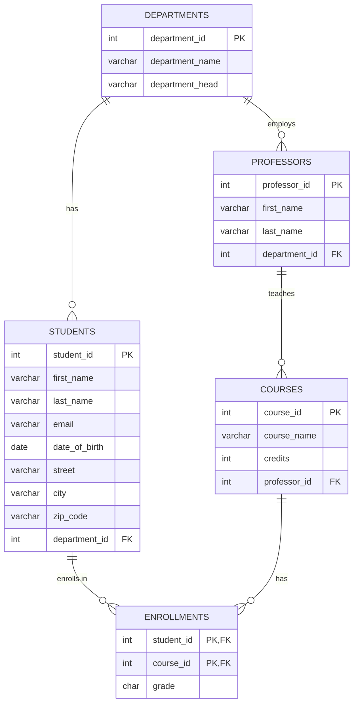
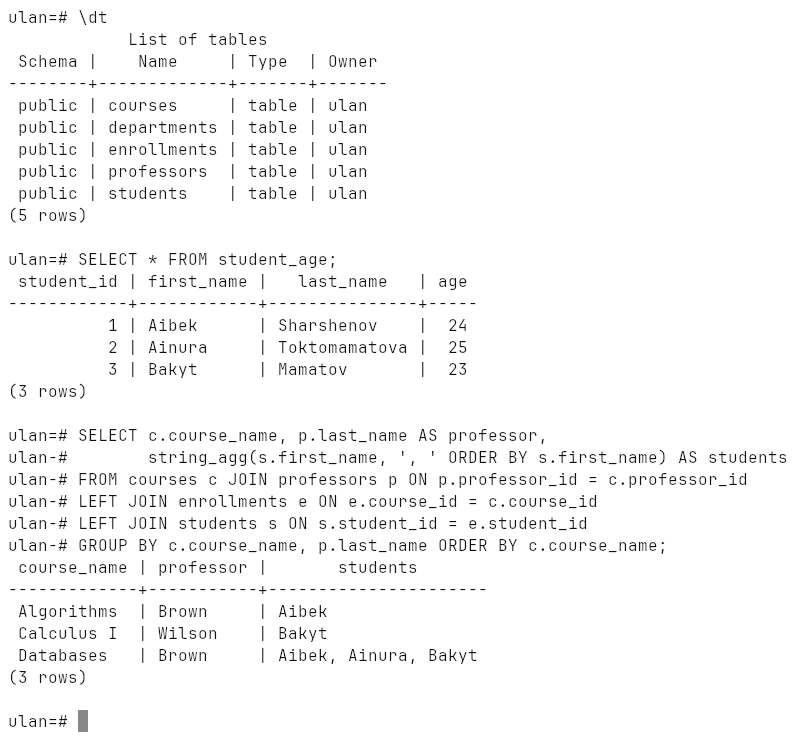
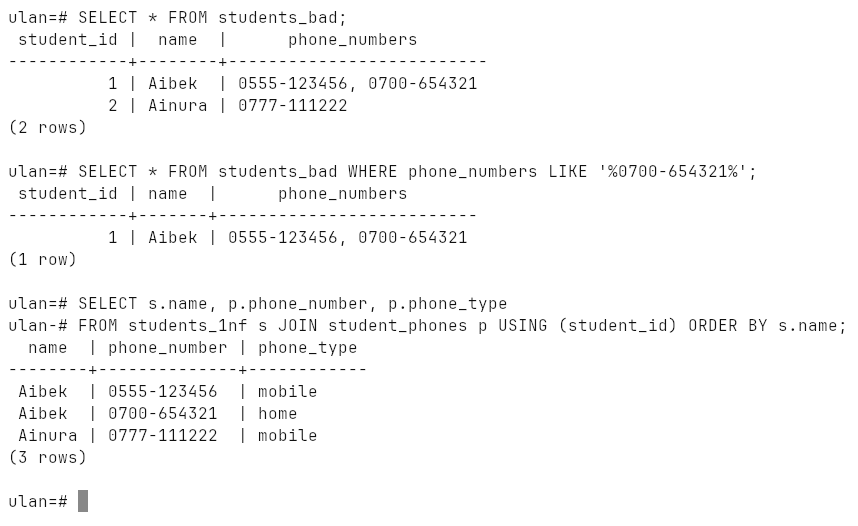
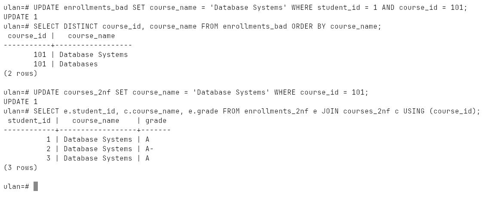
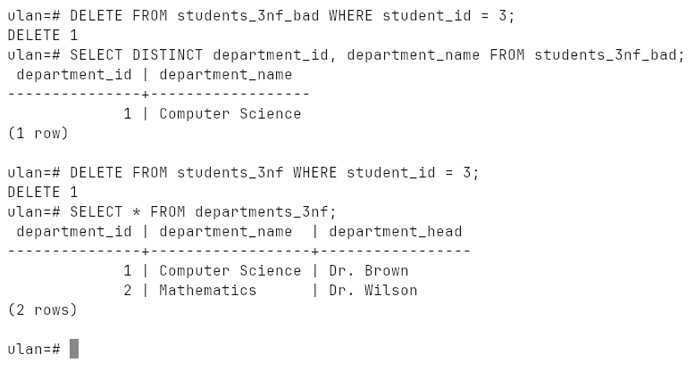
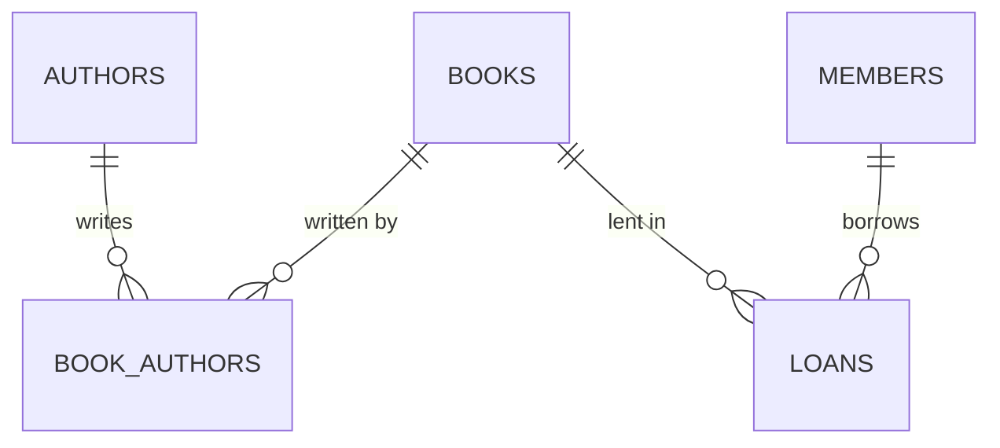
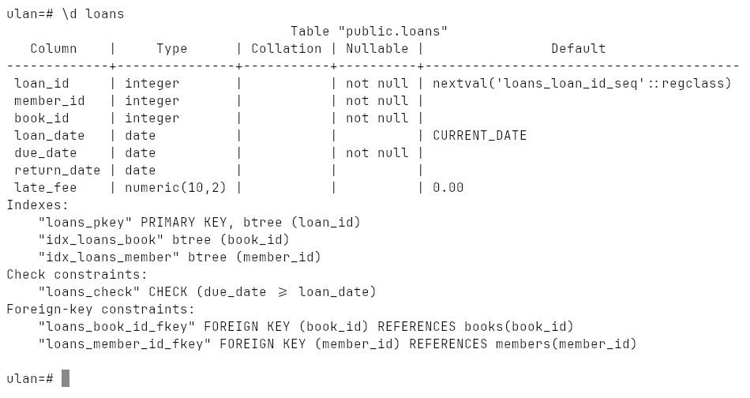
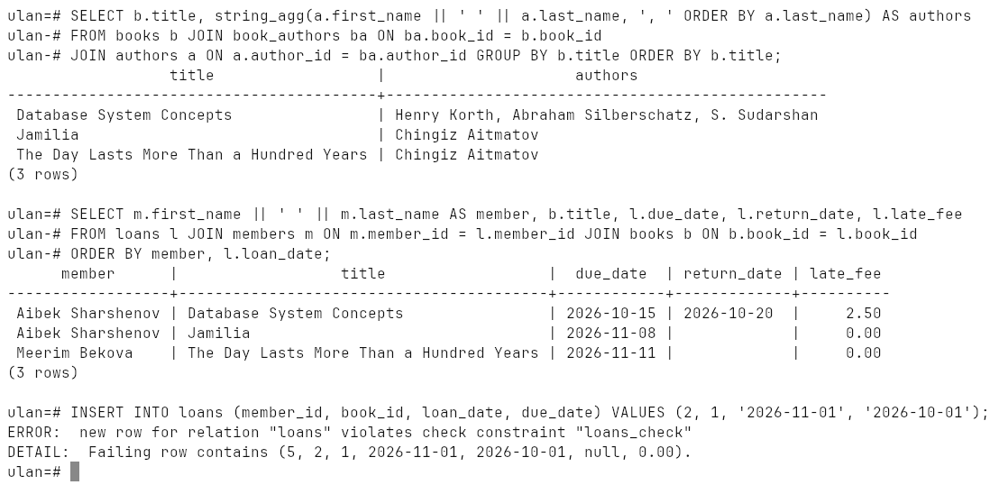

# Week 9: Database Design Basics

ER modelling, the three normal forms and the anomalies each one removes, and
the design process carried through on a library management system.

Run on PostgreSQL 18.6 (Windows 10, EDB installer, port `1569`).

## How to run

```bash
psql -h localhost -p 1569 -U ulan -d ulan -f lab.sql
```

Everything is in [`lab.sql`](lab.sql); it cleans up after itself.
Transcript: [`output.txt`](output.txt), screenshots: [`screenshots/`](screenshots).

## ER model of a small university



Entities become tables, attributes become columns, relationships become
foreign keys — or a junction table when they are many-to-many
(`enrollments`).

| Attribute kind | Example | How it is stored |
|---|---|---|
| simple | `first_name` | one column |
| composite | address | split into `street`, `city`, `zip_code` |
| derived | age | not stored; computed in the view `student_age` |
| key | `student_id` | `PRIMARY KEY` |



## Normalization

### 1NF — atomic values

`phone_numbers TEXT` holding `"0555-123456, 0700-654321"` is a list in a cell:
finding a phone needs `LIKE`, and there is nowhere to say which one is the
mobile. One phone per row in `student_phones` fixes both.



### 2NF — no partial dependency

In `enrollments_bad` the key is `(student_id, course_id)` but `course_name`
depends on `course_id` alone. Renaming the course in one row leaves the table
contradicting itself — an **update anomaly**. With `course_name` moved to
`courses_2nf` the rename is one row and cannot go out of sync.



### 3NF — no transitive dependency

`student_id → department_id → department_name`. Bakyt is the only Mathematics
student; deleting him also deletes the only record that the department
exists — a **delete anomaly**. With departments in their own table, the
department survives.



## Design process: library management system

1. **Requirements** — track books, authors, members and borrowing history;
   a member borrows many books; a book has many authors; due dates and late fees.
2. **Conceptual** — entities `Book`, `Author`, `Member`, `Loan`;
   Author *writes* Book (M:N), Member *borrows* through Loan (1:N).
3. **Logical** — tables, keys, normalized to 3NF; `book_authors` for M:N.
4. **Physical** — types (`DECIMAL(10,2)` for money, `VARCHAR(13)` for ISBN),
   `CHECK`s (`available_copies >= 0`, `due_date >= loan_date`) and indexes on
   the foreign keys used in joins.







## How to find entities and attributes

* **entities** — the nouns in the requirements: *"the library tracks books and
  members"*, *"students enroll in courses taught by professors"*;
* **attributes** — what has to be known about each of them for the business,
  for reports and for queries.
